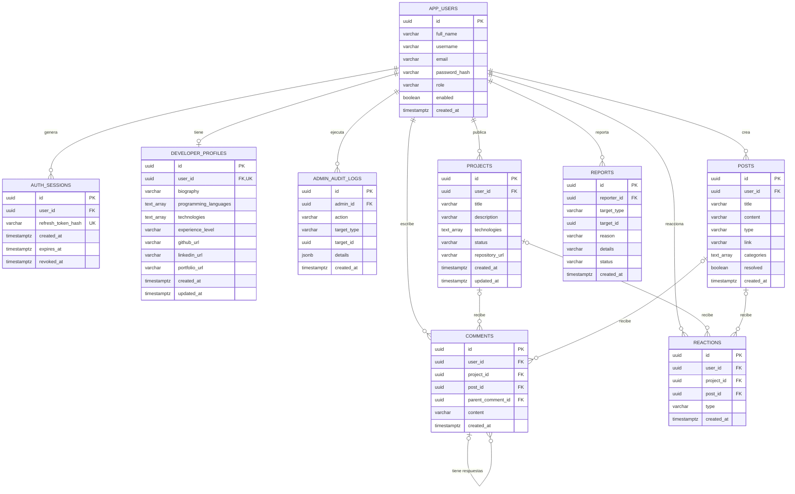

# DevConnect — Diseño de Base de Datos (Sprint 1 y 2)

**Fábrica Escuela 2026-2 · Facultad de Ingeniería · Rol: Bases de Datos**

Documentación del diseño de la base de datos de DevConnect, una red social para desarrolladores. Este repositorio integra el modelo inicial del Sprint 1 con las funcionalidades incorporadas en el Sprint 2, tomando como referencia las migraciones Flyway V1 a V12 del repositorio principal.

Repositorio del proyecto: [EAV02-Fabrica-Escuela](https://github.com/TheMax1270/EAV02-Fabrica-Escuela)

## Contenido de este repositorio

- [`schema.sql`](./schema.sql): script DDL con el modelo físico final, preparado para PostgreSQL.
- [`queries.sql`](./queries.sql): consultas SQL para responder las preguntas de negocio de los sprints 1 y 2.
- [`docs/modelo-entidad-relacion.md`](./docs/modelo-entidad-relacion.md): diagrama entidad-relación con las nueve entidades, sus atributos identificadores y las cardinalidades principales.
- [`README.md`](./README.md): documentación general del proyecto, instrucciones de ejecución y descripción de los entregables.
- [`docs/analisis-almacenamiento.md`](./docs/analisis-almacenamiento.md): estimaciones de almacenamiento, organización de índices, análisis de costos de consultas y optimización mediante álgebra relacional.


## Alcance de los sprints (rol Bases de Datos)

El modelo documenta las funcionalidades implementadas en el backend de DevConnect durante los sprints 1 y 2, a partir de las migraciones Flyway V1 a V12.

### Sprint 1: usuarios, autenticación y proyectos

| Funcionalidad | Tabla(s) asociada(s) |
|---|---|
| HU-01 — Registro de usuario | `users.app_users` |
| HU-02 — Inicio y cierre de sesión | `users.app_users`, `authentication.auth_sessions` |
| HU-03 — Crear y editar perfil técnico | `profiles.developer_profiles` |
| HU-04 — Publicar y editar proyectos | `projects.projects` |
| HU-05 — Gestionar usuarios | `users.app_users`, `admin.audit_logs` |
| Auditoría de acciones administrativas | `admin.audit_logs` |

### Sprint 2: publicaciones, interacciones y moderación

| Funcionalidad | Tabla(s) asociada(s) |
|---|---|
| Crear publicaciones generales y discusiones técnicas | `posts.posts` |
| Comentar publicaciones y proyectos | `interactions.comments` |
| Responder comentarios raíz | `interactions.comments` |
| Reaccionar a publicaciones y proyectos | `interactions.reactions` |
| Reportar contenido para moderación | `moderation.reports` |

### Alcance del modelo

El modelo físico integra las cinco tablas del Sprint 1 con las cuatro tablas incorporadas mediante las migraciones V9 a V12. Se documentan sus atributos, claves, restricciones, índices y relaciones, así como las decisiones de almacenamiento y seguridad.

Las funcionalidades descritas corresponden con la estructura de las migraciones compartidas. La asignación definitiva de cada funcionalidad a una historia de usuario deberá contrastarse con las historias aprobadas por el equipo.


## Organización en schemas

La base de datos se organiza en esquemas de PostgreSQL para separar las responsabilidades funcionales del sistema y facilitar la administración de permisos.

| Módulo | Schema | Tablas |
|---|---|---|
| Usuarios | `users` | `app_users` |
| Autenticación | `authentication` | `auth_sessions` |
| Perfiles | `profiles` | `developer_profiles` |
| Administración y auditoría | `admin` | `audit_logs` |
| Proyectos | `projects` | `projects` |
| Publicaciones | `posts` | `posts` |
| Interacciones | `interactions` | `comments`, `reactions` |
| Moderación | `moderation` | `reports` |

Las tablas se identifican mediante su nombre completamente calificado, compuesto por el esquema y el nombre de la tabla. Por ejemplo, `users.app_users` o `interactions.comments`.

### Criterios de organización

- **Separación por responsabilidad:** cada esquema agrupa tablas relacionadas con un módulo funcional.
- **Integridad referencial:** las claves foráneas conectan las entidades que dependen unas de otras.
- **Seguridad:** la separación por esquemas facilita documentar y asignar permisos según el rol de cada usuario.
- **Evolución del modelo:** los esquemas `posts`, `interactions` y `moderation` incorporan las funcionalidades del Sprint 2.

El esquema `public` conserva los objetos que se encuentren allí por configuración de PostgreSQL; las tablas de negocio descritas en este modelo se organizan en los esquemas indicados.


## 1. Entidades y relaciones




**Descripción de entidades**

- **`users.app_users`**: cuenta de cada usuario de la plataforma. El campo
  `role` distingue entre `DEVELOPER` y `ADMIN` (no hay tabla de roles
  separada; es un valor controlado por `CHECK`). `email` y `username` son
  únicos de forma case-insensitive (índices sobre `lower(...)`). El campo
  `enabled` representa el **estado de la cuenta**: `true` = activa, `false` =
  suspendida por un administrador; una cuenta suspendida no puede iniciar
  sesión ni usar sus sesiones existentes.
- **`authentication.auth_sessions`**: registra cada sesión (refresh token)
  emitida al iniciar sesión. Relación **1 a N** con `app_users`: un usuario
  puede tener varias sesiones activas (por ejemplo, en distintos
  dispositivos).
- **`profiles.developer_profiles`**: perfil técnico opcional de un usuario.
  Relación **1 a 1** con `app_users` (`user_id` es `UNIQUE`): un usuario
  tiene, como máximo, un perfil técnico.
- **`admin.audit_logs`**: bitácora de acciones administrativas. Cada fila
  registra **quién** (`admin_id`, FK a `app_users`), **qué** (`action`, hoy
  `USER_SUSPENDED` o `USER_REACTIVATED`), **sobre qué** (`target_type` +
  `target_id`) y **cuándo** (`created_at`). Relación **1 a N** con
  `app_users` a través de `admin_id`. La pareja `target_type`/`target_id` es
  una referencia *polimórfica*: hoy solo apunta a usuarios (`'USER'`), pero
  está pensada para registrar también moderación de publicaciones,
  comentarios o reportes en sprints posteriores, por eso no lleva FK. La
  columna `details` (`jsonb`) guarda contexto adicional de la acción, por
  ejemplo `{"previousStatus": "ACTIVE", "newStatus": "SUSPENDED"}`.
- **`projects.projects`**: proyecto técnico publicado por un desarrollador.
  Relación **1 a N** con `users.app_users`: un usuario puede publicar varios
  proyectos. El título, la descripción y las tecnologías son obligatorios;
  `status` registra si está en desarrollo, finalizado o buscando
  colaboradores, y `repository_url` permite asociar opcionalmente un
  repositorio GitHub o GitLab. Las imágenes no forman parte de este alcance.

### Entidades incorporadas en el Sprint 2

- **`posts.posts`**: almacena las publicaciones creadas por los usuarios. El atributo `type` diferencia las publicaciones generales (`GENERAL`) de las discusiones técnicas (`TECHNICAL_DISCUSSION`). El título puede ser nulo en publicaciones generales, pero es obligatorio y no puede estar en blanco para las discusiones técnicas. `content` siempre es obligatorio. Las categorías se almacenan en un arreglo de texto, con un máximo de 20 elementos. El campo `resolved` indica si una discusión está resuelta; las publicaciones generales deben permanecer con este valor en `false`. El campo `link` es opcional y, cuando se informa, debe comenzar por `http://` o `https://`.

- **`interactions.comments`**: registra los comentarios realizados por los usuarios sobre proyectos o publicaciones. Las columnas `project_id` y `post_id` permiten identificar el contenido comentado, pero una restricción `CHECK` exige que solo una de ellas tenga valor. `parent_comment_id` identifica el comentario raíz al que responde una respuesta. Las restricciones de integridad impiden responder a un comentario que pertenezca a otro contenido o que no sea raíz. Los atributos generados `target_type`, `target_id` e `is_root` permiten reforzar estas reglas.

- **`interactions.reactions`**: registra las reacciones de los usuarios sobre proyectos o publicaciones. Al igual que en los comentarios, cada reacción debe apuntar a un único tipo de contenido. Actualmente, el único tipo permitido es `LIKE`. Los índices únicos parciales impiden que un usuario registre más de una reacción del mismo tipo sobre el mismo proyecto o publicación.

- **`moderation.reports`**: almacena los reportes enviados por usuarios para solicitar la revisión de un contenido. Registra al usuario que reporta, el tipo e identificador del contenido, el motivo, los detalles opcionales, el estado y la fecha de creación. La migración establece un índice único parcial que impide que un mismo usuario tenga más de un reporte `PENDING` para el mismo contenido. `target_id` es una referencia polimórfica: no cuenta con una clave foránea directa hacia proyectos o publicaciones.

## 2. Preguntas de negocio clave

1. ¿Cuántos usuarios hay registrados por rol (`DEVELOPER` vs `ADMIN`)?
2. ¿Qué usuarios tienen la cuenta suspendida (`enabled = false`)?
3. ¿Cuáles son las sesiones activas (no revocadas y no expiradas) de un
   usuario específico?
4. ¿Qué desarrolladores de nivel `SENIOR` dominan un lenguaje de programación
   determinado (por ejemplo, `Java`)?
5. ¿Cuántos perfiles técnicos existen por nivel de experiencia
   (`JUNIOR`, `SEMI_SENIOR`, `SENIOR`)?
6. ¿Cuál es el usuario con más sesiones generadas históricamente (posible
   señal de uso frecuente o de abuso de tokens)?
7. ¿Cuál es el historial de acciones administrativas (suspensiones y
   reactivaciones) sobre un usuario específico, y qué administrador ejecutó
   cada una?
8. ¿Cuántas suspensiones y reactivaciones ha ejecutado cada administrador?
9. ¿Qué cuentas están suspendidas actualmente, desde cuándo y quién las
   suspendió?
10. ¿Qué acciones administrativas se realizaron en los últimos 7 días?

11. (HU-06) ¿Cuántas publicaciones hay por tipo (actualización general o
    discusión técnica) y cuántas están resueltas?
12. (HU-06) ¿Qué discusiones técnicas siguen abiertas para una categoría o
    tecnología determinada?
13. (HU-07) ¿Cuántos comentarios y respuestas tiene cada publicación?
14. (HU-07) ¿Cuántas reacciones tiene cada publicación?
15. (HU-09) ¿Qué tipos de contenido o perfiles acumulan más reportes
    pendientes?
16. (HU-09) ¿Qué reportes ha enviado un usuario específico y en qué estado
    están?
17. (HU-10) ¿Cómo se priorizan los reportes por estado, motivo y tipo de
    destino, empezando por los pendientes más antiguos?

Las consultas SQL que resuelven cada pregunta están en la sección 7 y en
[`queries.sql`](./queries.sql).

## 3. Modelo lógico

| Tabla | Columna | Tipo | Restricciones |
|---|---|---|---|
| `users.app_users` | `id` | uuid | PK |
| | `full_name` | varchar(150) | NOT NULL |
| | `username` | varchar(50) | NOT NULL, único (case-insensitive) |
| | `email` | varchar(254) | NOT NULL, único (case-insensitive) |
| | `password_hash` | varchar(255) | NOT NULL |
| | `role` | varchar(30) | NOT NULL, CHECK IN ('DEVELOPER','ADMIN') |
| | `enabled` | boolean | NOT NULL (`true` activa, `false` suspendida) |
| | `created_at` | timestamptz | NOT NULL |
| `authentication.auth_sessions` | `id` | uuid | PK |
| | `user_id` | uuid | NOT NULL, FK → `users.app_users(id)` |
| | `refresh_token_hash` | varchar(64) | NOT NULL, único |
| | `created_at` | timestamptz | NOT NULL |
| | `expires_at` | timestamptz | NOT NULL, CHECK > created_at |
| | `revoked_at` | timestamptz | nullable |
| `profiles.developer_profiles` | `id` | uuid | PK |
| | `user_id` | uuid | NOT NULL, FK único → `users.app_users(id)` |
| | `biography` | varchar(500) | NOT NULL |
| | `programming_languages` | text[] | NOT NULL |
| | `technologies` | text[] | NOT NULL |
| | `experience_level` | varchar(20) | NOT NULL, CHECK IN ('JUNIOR','SEMI_SENIOR','SENIOR') |
| | `github_url` / `linkedin_url` / `portfolio_url` | varchar(500) | nullable |
| | `created_at` / `updated_at` | timestamptz | NOT NULL, CHECK updated_at >= created_at |
| `admin.audit_logs` | `id` | uuid | PK |
| | `admin_id` | uuid | NOT NULL, FK → `users.app_users(id)` |
| | `action` | varchar(100) | NOT NULL (`USER_SUSPENDED`, `USER_REACTIVATED`) |
| | `target_type` | varchar(50) | NOT NULL (`USER`) |
| | `target_id` | uuid | NOT NULL, sin FK (referencia polimórfica) |
| | `details` | jsonb | nullable |
| | `created_at` | timestamptz | NOT NULL |
| `projects.projects` | `id` | uuid | PK |
| | `user_id` | uuid | NOT NULL, FK → `users.app_users(id)` |
| | `title` | varchar(150) | NOT NULL |
| | `description` | varchar(2000) | NOT NULL |
| | `technologies` | text[] | NOT NULL |
| | `status` | varchar(30) | NOT NULL |
| | `repository_url` | varchar(500) | nullable |
| | `created_at` / `updated_at` | timestamptz | NOT NULL |

**Decisiones de diseño en `admin.audit_logs`**

- `target_type` + `target_id` **no** tienen clave foránea: la tabla es
  genérica para cualquier acción administrativa (usuarios hoy; publicaciones,
  comentarios y reportes en los sprints de moderación). Una FK a `app_users`
  impediría reutilizarla. El índice compuesto `(target_type, target_id)`
  mantiene eficientes las búsquedas por objetivo.
- `admin_id` **sí** tiene FK, pero **sin** `ON DELETE CASCADE`: la
  trazabilidad debe sobrevivir a la cuenta que la generó. Esto también es
  coherente con el alcance de HU-08, donde las cuentas se suspenden en lugar
  de eliminarse precisamente para conservar la trazabilidad.
- `action` se almacena como texto en lugar de `CHECK`/enum para poder
  agregar nuevas acciones sin migraciones de esquema; el dominio se controla
  en la aplicación (enum `AdminAction` del backend).
- `details` es `jsonb` porque su contenido depende de la acción (para una
  suspensión guarda el estado anterior y el nuevo); una columna por cada
  posible dato produciría muchas columnas nulas.


## Normalización

El modelo separa las principales entidades del sistema en tablas independientes y utiliza claves primarias, claves foráneas y restricciones para mantener la integridad de los datos. La evaluación de las formas normales debe considerar tanto las dependencias funcionales como la estructura de los atributos.

### Primera forma normal (1FN)

La mayoría de los atributos almacenan valores individuales. Sin embargo, existen excepciones deliberadas: `programming_languages` y `technologies` en `profiles.developer_profiles`, `technologies` en `projects.projects` y `categories` en `posts.posts` utilizan arreglos `TEXT[]`.

Estos atributos multivaluados no cumplen estrictamente el principio de atomicidad de la 1FN. Se conservaron para simplificar el modelo inicial. Una alternativa sería crear tablas relacionadas para almacenar cada lenguaje, tecnología o categoría como un registro independiente.

### Segunda forma normal (2FN)

Todas las tablas utilizan claves primarias simples (`id`). Por tanto, no existen dependencias parciales respecto de claves primarias compuestas. Esto no sustituye la revisión de las dependencias funcionales de cada entidad, pero permite identificar que las claves actuales no generan ese tipo de dependencia parcial.

### Tercera forma normal (3FN)

La separación de usuarios, perfiles, proyectos, publicaciones, comentarios, reacciones, sesiones, auditoría y reportes reduce la duplicación de datos entre entidades. Las relaciones explícitas se implementan mediante claves foráneas cuando corresponde.

El cumplimiento estricto de 3FN debe verificarse a partir de las dependencias funcionales de cada tabla. La presencia de claves primarias simples, por sí sola, no demuestra que todo el modelo esté en 3FN.

### Decisiones de diseño y mejoras propuestas

- **Perfiles técnicos:** se podrían crear tablas de lenguajes de programación y tecnologías relacionadas con `developer_profiles`.
- **Proyectos:** se podría normalizar `projects.technologies` mediante una tabla de tecnologías y una tabla intermedia para la relación entre proyectos y tecnologías.
- **Publicaciones:** se podría normalizar `posts.categories` mediante tablas de categorías y de asociación con publicaciones.

Estas mejoras permitirían consultar y reutilizar los valores de manera más estructurada. Su implementación dependería de las necesidades de consulta y de las decisiones del equipo; no forman parte del modelo físico actual documentado.


## 4. Modelo físico

El modelo físico se implementa en PostgreSQL y se encuentra definido en [`schema.sql`](./schema.sql). Integra las cinco tablas del Sprint 1 y las cuatro tablas incorporadas en el Sprint 2, de acuerdo con las migraciones Flyway V1 a V12 del proyecto principal.

### Estructura de la base de datos

El modelo contiene nueve tablas distribuidas en ocho schemas:

| Schema | Tabla | Propósito |
|---|---|---|
| `users` | `app_users` | Cuentas y datos principales de los usuarios. |
| `authentication` | `auth_sessions` | Sesiones de autenticación. |
| `profiles` | `developer_profiles` | Información técnica de los desarrolladores. |
| `admin` | `audit_logs` | Registro de acciones administrativas. |
| `projects` | `projects` | Proyectos publicados por los usuarios. |
| `posts` | `posts` | Publicaciones generales y discusiones técnicas. |
| `interactions` | `comments` | Comentarios y respuestas a comentarios raíz. |
| `interactions` | `reactions` | Reacciones sobre proyectos y publicaciones. |
| `moderation` | `reports` | Reportes de contenido para moderación. |

### Tipos de datos y restricciones

El modelo utiliza tipos de datos específicos de PostgreSQL, entre ellos `UUID` para identificadores, `VARCHAR` para cadenas de longitud limitada, `TEXT[]` para colecciones de texto, `TIMESTAMPTZ` para fechas y horas con zona horaria y `JSONB` para información semiestructurada de auditoría.

Las restricciones de integridad incluyen:

- **`PRIMARY KEY`:** identifica de forma única cada registro.
- **`FOREIGN KEY`:** mantiene las relaciones entre entidades cuando están definidas explícitamente.
- **`NOT NULL`:** exige valores en los atributos obligatorios.
- **`UNIQUE`:** evita duplicados en los atributos o combinaciones correspondientes.
- **`CHECK`:** valida reglas de dominio y coherencia de los datos.
- **`DEFAULT`:** asigna valores iniciales cuando no se proporciona uno, como `FALSE` en `posts.resolved` y `LIKE` en `interactions.reactions.type`.

### Índices

El modelo define índices para apoyar las consultas frecuentes y las restricciones de unicidad. Entre ellos se encuentran:

- Índices únicos insensibles a mayúsculas y minúsculas para el correo electrónico y el nombre de usuario.
- Índices sobre claves foráneas y columnas de búsqueda, como los identificadores de usuario.
- Índices para consultar sesiones por usuario y fecha de expiración.
- Índices para consultar publicaciones por fecha e identificador.
- Índices parciales para comentarios raíz, respuestas y reacciones, según el contenido asociado.
- Índices para localizar reportes por contenido y evitar reportes pendientes duplicados del mismo usuario para el mismo objetivo.

La existencia de un índice no reemplaza la validación de integridad mediante restricciones. Los índices y las restricciones descritos deben coincidir con la definición real de ``.

### Ejecución del script

El script debe poder ejecutarse sobre una base de datos PostgreSQL vacía, respetando las dependencias entre esquemas, tablas, claves foráneas e índices.

Con `psql`, se puede ejecutar mediante:

```bash
psql "postgresql://<usuario>:<password>@<host>:<puerto>/<basededatos>" -f
```

También se puede ejecutar desde el SQL Editor de Supabase sobre una base de datos de prueba vacía. Se recomienda validar primero el script en un entorno de pruebas y comprobar que todas las tablas, restricciones e índices se creen correctamente.

## 5. Trazabilidad con el backend

Este esquema corresponde 1 a 1 con las migraciones Flyway del repositorio
principal (`backend/src/main/resources/db/migration`):

| Migración | Contenido |
|---|---|
| `V1__create_app_users.sql` | Creación de `app_users` |
| `V2__create_auth_sessions.sql` | Creación de `auth_sessions` |
| `V3__fix_auth_session_refresh_token_type.sql` | Ajuste de tipo de `refresh_token_hash` |
| `V5__recreate_developer_profiles.sql` | Versión vigente de `developer_profiles` (reemplaza a `V4`) |
| `V6__create_admin_audit_logs.sql` | Creación del schema `admin` y de `admin.audit_logs` con sus índices |
| `V7__move_tables_to_domain_schemas.sql` | Creación de `users`, `authentication` y `profiles`; traslado de las tablas existentes con `SET SCHEMA` |
| `V8__create_projects.sql` | Creación del schema `projects` y de `projects.projects` para publicar y editar proyectos |
| `V9__create_posts.sql` | Creación de la tabla `posts.posts` para publicaciones. |
| `V10__extend_post_types.sql` | Ampliación de los tipos de publicación admitidos. |
| `V11__create_interactions.sql` | Creación de las tablas de comentarios y reacciones. |
| `V12__create_reports.sql` | Creación de la tabla de reportes para moderación. |

`schema.sql` consolida el estado final del modelo después de aplicar las migraciones `V1` a `V12`. Reproduce directamente la estructura definitiva de los esquemas y tablas, incluyendo las funcionalidades de publicaciones, interacciones y reportes incorporadas en las migraciones posteriores. Por eso, el script permite crear la estructura final en una base de datos vacía sin ejecutar las migraciones una por una.

## 6. Seguridad y privilegios de la base de datos

### 6.1. Estrategia de seguridad

Se definió una estrategia de control de acceso basada en roles de PostgreSQL, aplicando el principio de mínimo privilegio. El objetivo es asignar a cada rol únicamente los permisos necesarios para sus responsabilidades, evitando modificaciones no autorizadas sobre los datos y los registros de auditoría.

La configuración se encuentra en el archivo `security.sql`, el cual se ejecutó y validó en una instancia local de PostgreSQL mediante Docker. Esta configuración corresponde a una propuesta de permisos para la base de datos; su integración con el backend deberá coordinarse con el equipo responsable de dicha capa.

### 6.2. Roles definidos

| Rol | Tipo de acceso | Permisos principales |
|---|---|---|
| `db_readonly` | Solo lectura | Consultar las nueve tablas del modelo físico. |
| `app_runtime` | Operación de la aplicación | Consultar y gestionar datos operativos según los permisos asignados. Puede registrar reportes y consultar auditoría, pero no actualizar ni eliminar reportes, ni modificar o eliminar registros de auditoría. |
| `app_moderator` | Moderación | Consultar y actualizar reportes, además de consultar los registros de auditoría. No puede eliminar reportes mediante los permisos asignados. |

Los tres roles se crearon con el atributo `NOLOGIN`, por lo que funcionan como roles de privilegios y no como cuentas de conexión. Las credenciales y la asignación de estos permisos a la conexión de la aplicación deben definirse con el equipo de backend.

### 6.3. Asignación de permisos

El script `security.sql` utiliza instrucciones `GRANT` para asignar permisos y `REVOKE` para retirar los privilegios de tablas concedidos al rol `PUBLIC` en los ocho esquemas de negocio.

Los permisos se asignan por esquema y tabla. El rol `db_readonly` recibe `SELECT` en todas las tablas. El rol `app_runtime` recibe permisos operativos sobre las tablas funcionales, con restricciones específicas en `moderation.reports` y `admin.audit_logs`. El rol `app_moderator` recibe permisos de consulta y actualización sobre los reportes, sin permiso de eliminación.

### 6.4. Validación de la configuración

La configuración se probó en una base de datos local mediante consultas a los catálogos y funciones de privilegios de PostgreSQL. Se obtuvieron los siguientes resultados:

- Se verificó la existencia de los tres roles y su atributo `NOLOGIN`.
- Se comprobó que `db_readonly` puede consultar las nueve tablas del modelo físico.
- Se verificó que `db_readonly` no tiene permiso para insertar usuarios.
- Se comprobó que `app_runtime` puede registrar reportes, pero no actualizarlos ni eliminar registros de auditoría.
- Se verificó que `app_moderator` puede actualizar reportes, pero no eliminarlos.

Estas pruebas evidencian que los privilegios principales corresponden al diseño propuesto y que existen restricciones diferenciadas entre los roles.

### 6.5. Alcance y consideraciones

La configuración validada corresponde a una prueba local de permisos de PostgreSQL. No se ha aplicado a la instancia compartida de Supabase ni se afirma que el backend ya utilice estos roles. La integración deberá coordinarse con el equipo de backend, incluyendo la asignación de una cuenta de conexión autorizada y la revisión de los permisos requeridos por cada operación.

Esta estrategia implementa control de acceso mediante roles y privilegios de base de datos; no sustituye los controles de autenticación y autorización que correspondan a la aplicación.

## 7. Consultas SQL de los Sprints 1 y 2

Cada consulta responde una de las preguntas de negocio clave (sección 2) y se
ejecuta sobre las tablas creadas por `schema.sql`, en `psql`, pgAdmin o el SQL
Editor de Supabase. Las que filtran por usuario usan el nombre de usuario de
ejemplo `usuario_demo`, que se cambia por el real. El mismo código está en
[`queries.sql`](./queries.sql).

### Sprint 1

#### Consulta 1. ¿Cuántos usuarios hay registrados por rol?

```sql
SELECT role, COUNT(*) AS total_usuarios
FROM users.app_users
GROUP BY role;
```

#### Consulta 2. ¿Qué usuarios tienen la cuenta suspendida?

```sql
SELECT id, full_name, username, email
FROM users.app_users
WHERE enabled = false;
```

#### Consulta 3. ¿Cuáles son las sesiones activas de un usuario?

```sql
SELECT s.id, s.created_at, s.expires_at
FROM authentication.auth_sessions s
WHERE s.user_id = (SELECT id FROM users.app_users WHERE username = 'usuario_demo')
  AND s.revoked_at IS NULL
  AND s.expires_at > now();
```

#### Consulta 4. ¿Qué desarrolladores SENIOR dominan un lenguaje (ej. Java)?

```sql
SELECT u.full_name, u.username, dp.experience_level
FROM profiles.developer_profiles dp
JOIN users.app_users u ON u.id = dp.user_id
WHERE dp.experience_level = 'SENIOR'
  AND 'Java' = ANY (dp.programming_languages);
```

#### Consulta 5. ¿Cuántos perfiles técnicos hay por nivel de experiencia?

```sql
SELECT experience_level, COUNT(*) AS total_perfiles
FROM profiles.developer_profiles
GROUP BY experience_level
ORDER BY total_perfiles DESC;
```

#### Consulta 6. ¿Qué usuario ha generado más sesiones?

```sql
SELECT u.username, COUNT(s.id) AS total_sesiones
FROM users.app_users u
JOIN authentication.auth_sessions s ON s.user_id = u.id
GROUP BY u.username
ORDER BY total_sesiones DESC
LIMIT 1;
```

#### Consulta 7. ¿Cuál es el historial de acciones administrativas sobre un usuario?

```sql
SELECT l.created_at, l.action, a.username AS administrador, l.details
FROM admin.audit_logs l
JOIN users.app_users a ON a.id = l.admin_id
WHERE l.target_type = 'USER'
  AND l.target_id = (SELECT id FROM users.app_users WHERE username = 'usuario_demo')
ORDER BY l.created_at DESC;
```

#### Consulta 8. ¿Cuántas suspensiones y reactivaciones ha ejecutado cada administrador?

```sql
SELECT a.username AS administrador, l.action, COUNT(*) AS total
FROM admin.audit_logs l
JOIN users.app_users a ON a.id = l.admin_id
WHERE l.action IN ('USER_SUSPENDED', 'USER_REACTIVATED')
GROUP BY a.username, l.action
ORDER BY a.username, l.action;
```

#### Consulta 9. ¿Qué cuentas están suspendidas, desde cuándo y quién las suspendió?

```sql
SELECT u.username, u.email, ultima.created_at AS suspendida_en, a.username AS suspendida_por
FROM users.app_users u
JOIN LATERAL (
    SELECT l.admin_id, l.created_at
    FROM admin.audit_logs l
    WHERE l.target_type = 'USER'
      AND l.target_id = u.id
      AND l.action = 'USER_SUSPENDED'
    ORDER BY l.created_at DESC
    LIMIT 1
) ultima ON true
JOIN users.app_users a ON a.id = ultima.admin_id
WHERE u.enabled = false
ORDER BY ultima.created_at DESC;
```

#### Consulta 10. ¿Qué acciones administrativas se realizaron en los últimos 7 días?

```sql
SELECT l.created_at, a.username AS administrador, l.action, l.target_type, l.target_id
FROM admin.audit_logs l
JOIN users.app_users a ON a.id = l.admin_id
WHERE l.created_at >= now() - interval '7 days'
ORDER BY l.created_at DESC;
```

### Sprint 2

#### Consulta 11 (HU-06). ¿Cuántas publicaciones hay por tipo y cuántas están resueltas?

```sql
SELECT type,
       COUNT(*) AS total_publicaciones,
       COUNT(*) FILTER (WHERE resolved = TRUE) AS resueltas
FROM posts.posts
GROUP BY type
ORDER BY total_publicaciones DESC;
```

#### Consulta 12 (HU-06). ¿Qué discusiones técnicas siguen abiertas para una tecnología?

```sql
SELECT p.id, p.title, p.created_at, u.username AS autor
FROM posts.posts p
JOIN users.app_users u ON u.id = p.user_id
WHERE p.type = 'TECHNICAL_DISCUSSION'
  AND p.resolved = FALSE
  AND 'flyway' = ANY (p.categories)
ORDER BY p.created_at DESC;
```

#### Consulta 13 (HU-07). ¿Cuántos comentarios y respuestas tiene cada publicación?

```sql
SELECT p.id AS post_id,
       p.title,
       COUNT(c.id) AS total_comentarios,
       COUNT(c.id) FILTER (WHERE c.is_root = TRUE) AS comentarios_raiz,
       COUNT(c.id) FILTER (WHERE c.is_root = FALSE) AS respuestas
FROM posts.posts AS p
LEFT JOIN interactions.comments AS c ON c.post_id = p.id
GROUP BY p.id, p.title
ORDER BY total_comentarios DESC;
```

#### Consulta 14 (HU-07). ¿Cuántas reacciones tiene cada publicación?

```sql
SELECT p.id AS post_id,
       p.title,
       COUNT(r.id) AS total_reacciones
FROM posts.posts AS p
LEFT JOIN interactions.reactions AS r ON r.post_id = p.id
GROUP BY p.id, p.title
ORDER BY total_reacciones DESC;
```

#### Consulta 15 (HU-09). ¿Qué tipos de contenido o perfiles acumulan más reportes pendientes?

```sql
SELECT target_type,
       COUNT(*) AS total_reportes_pendientes
FROM moderation.reports
WHERE status = 'PENDING'
GROUP BY target_type
ORDER BY total_reportes_pendientes DESC;
```

#### Consulta 16 (HU-09). ¿Qué reportes ha enviado un usuario y en qué estado están?

```sql
SELECT id AS report_id, target_type, target_id, reason, details, status, created_at
FROM moderation.reports
WHERE reporter_id = (SELECT id FROM users.app_users WHERE username = 'usuario_demo')
ORDER BY created_at DESC;
```

#### Consulta 17 (HU-10). ¿Cómo se priorizan los reportes, empezando por los pendientes más antiguos?

```sql
SELECT status, reason, target_type,
       COUNT(*) AS total_reportes,
       MIN(created_at) AS reporte_mas_antiguo
FROM moderation.reports
GROUP BY status, reason, target_type
ORDER BY CASE WHEN status = 'PENDING' THEN 0 ELSE 1 END,
         reporte_mas_antiguo ASC;
```

## INTEGRANTES:

- DURANGO DURANGO DANIEL DAVID
- GOMEZ CASTANO JUAN JOSE
- MEDRANO ORTEGA BRYAN
- PATERNINA YEPES KAREN VANESSA
- VARGAS TIRADO MATEO
