# DevConnect — Diseño de Base de Datos (Sprints 1, 2 y 3)

**Fábrica Escuela 2026-2 · Facultad de Ingeniería · Rol: Bases de Datos**

Documentación del diseño de la base de datos de DevConnect, una red social para desarrolladores. Este repositorio integra el modelo inicial del Sprint 1 con las funcionalidades incorporadas en los Sprints 2 y 3, tomando como referencia las migraciones Flyway V1 a V18 del repositorio principal. Los cambios del Sprint 3 se resumen en la sección [Cambios respecto al Sprint 2](#cambios-respecto-al-sprint-2).

Repositorio del proyecto: [EAV02-Fabrica-Escuela](https://github.com/TheMax1270/EAV02-Fabrica-Escuela)

## Contenido de este repositorio

- [`schema.sql`](./schema.sql): script DDL con el modelo físico final, preparado para PostgreSQL.
- [`queries.sql`](./queries.sql): consultas SQL para responder las preguntas de negocio de los sprints 1 y 2.
- [`docs/modelo-entidad-relacion.md`](./docs/modelo-entidad-relacion.md): diagrama entidad-relación con las catorce entidades, sus atributos identificadores y las cardinalidades principales.
- [`README.md`](./README.md): documentación general del proyecto, instrucciones de ejecución y descripción de los entregables.
- [`docs/analisis-almacenamiento.md`](./docs/analisis-almacenamiento.md): estimaciones de almacenamiento, organización de índices, análisis de costos de consultas y optimización mediante álgebra relacional.


## Alcance de los sprints (rol Bases de Datos)

El modelo documenta las funcionalidades implementadas en el backend de DevConnect durante los sprints 1, 2 y 3, a partir de las migraciones Flyway V1 a V18.

### Sprint 1: usuarios, autenticación y proyectos

| Funcionalidad | Tabla(s) asociada(s) |
|---|---|
| HU-01 — Registro de usuario | `users.app_users` |
| HU-02 — Inicio y cierre de sesión | `users.app_users`, `authentication.auth_sessions` |
| HU-03 — Crear y editar perfil técnico | `profiles.developer_profiles` |
| HU-04 — Publicar y editar proyectos | `projects.projects` |
| HU-05 — Gestionar usuarios | `users.app_users`, `admin.audit_logs` |
| Auditoría de acciones administrativas | `admin.audit_logs` |

### Sprint 2: publicaciones, interacciones y moderación

| Historia de usuario | Funcionalidad | Tabla(s) asociada(s) |
|---|---|---|
| **HU-06 - Crear, gestionar y eliminar publicaciones y discusiones técnicas** | Crear publicaciones generales y discusiones técnicas. | `posts.posts` |
| **HU-07 - Comentar, responder y reaccionar** | Comentar publicaciones y proyectos, responder comentarios raíz y registrar reacciones. | `interactions.comments`, `interactions.reactions` |
| **HU-08 - Seguir y dejar de seguir desarrolladores** | Registrar las relaciones de seguimiento entre desarrolladores. | `interactions.user_follows` |
| **HU-09 - Reportar contenido o perfiles** | Registrar reportes de contenido o perfiles para su revisión. | `moderation.reports` |
| **HU-10 - Gestionar reportes y moderar contenido** | Consultar, priorizar y gestionar reportes, y cambiar el estado de moderación del contenido (visible, en revisión o removido). | `moderation.reports`; columna `moderation_status` de `posts.posts`, `interactions.comments` y `profiles.developer_profiles` |

### Sprint 3: bloqueos, mensajería, notificaciones y estadísticas

| Historia de usuario | Funcionalidad | Tabla(s) asociada(s) |
|---|---|---|
| **HU-11 - Bloquear usuarios** | Bloquear y desbloquear a otro usuario. El bloqueo impide enviarse mensajes y seguirse, y elimina los seguimientos entre ambos. | `interactions.user_blocks` (V16) |
| **HU-12 - Mensajería privada uno a uno** | Enviar mensajes de texto y consultar el historial de una conversación, que es única para cada par de usuarios. | `messaging.conversations`, `messaging.messages` (V17) |
| **HU-13 - Notificaciones in-app** | Notificar comentarios, reacciones, nuevos seguidores y mensajes; mostrar el contador de no leídas y marcarlas como leídas. | `notifications.notifications` (V18) |
| **HU-14 - Estadísticas de crecimiento y actividad** | Métricas de usuarios y de actividad por rango de fechas, agrupadas por semana o mes. | Sin tablas nuevas; consulta `created_at` de las tablas existentes |

### Alcance del modelo

El modelo físico integra las cinco tablas del Sprint 1, las cinco del Sprint 2 (migraciones V9 a V15) y las cuatro del Sprint 3 (migraciones V16 a V18). Se documentan sus atributos, claves, restricciones, índices y relaciones, así como las decisiones de almacenamiento y seguridad.

Las funcionalidades descritas corresponden con la estructura de las migraciones compartidas. La asignación definitiva de cada funcionalidad a una historia de usuario deberá contrastarse con las historias aprobadas por el equipo.


## Organización en schemas

La base de datos se organiza en esquemas de PostgreSQL para separar las responsabilidades funcionales del sistema y facilitar la administración de permisos.

| Módulo | Schema | Tablas |
|---|---|---|
| Usuarios | `users` | `app_users` |
| Autenticación | `authentication` | `auth_sessions` |
| Perfiles | `profiles` | `developer_profiles` |
| Administración y auditoría | `admin` | `audit_logs` |
| Proyectos | `projects` | `projects` |
| Publicaciones | `posts` | `posts` |
| Interacciones | `interactions` | `comments`, `reactions`, `user_follows`, `user_blocks` |
| Moderación | `moderation` | `reports` |
| Mensajería | `messaging` | `conversations`, `messages` |
| Notificaciones | `notifications` | `notifications` |

Las tablas se identifican mediante su nombre completamente calificado, compuesto por el esquema y el nombre de la tabla. Por ejemplo, `users.app_users` o `interactions.comments`.

### Criterios de organización

- **Separación por responsabilidad:** cada esquema agrupa tablas relacionadas con un módulo funcional.
- **Integridad referencial:** las claves foráneas conectan las entidades que dependen unas de otras.
- **Seguridad:** la separación por esquemas facilita documentar y asignar permisos según el rol de cada usuario.
- **Evolución del modelo:** los esquemas `posts`, `interactions` y `moderation` incorporan las funcionalidades del Sprint 2. En el Sprint 3 se agregan `messaging` y `notifications`, e `interactions` incorpora `user_blocks`.

El esquema `public` conserva los objetos que se encuentren allí por configuración de PostgreSQL; las tablas de negocio descritas en este modelo se organizan en los esquemas indicados.


## Cambios respecto al Sprint 2

Esta sección resume lo nuevo o modificado en el Sprint 3 frente a la entrega del Sprint 2 (migraciones V1 a V15), organizado por entregable.

### MER

| Cambio | Tipo | HU | Justificación |
|---|---|---|---|
| Nueva entidad `USER_BLOCKS` con relaciones 1:N desde `APP_USERS` como bloqueador y como bloqueado | Entidad y relaciones nuevas | HU-11 | El bloqueo es una relación dirigida entre dos usuarios. Se modela como tabla asociativa (igual que `USER_FOLLOWS`) para admitir muchos bloqueos por usuario y conservar la fecha. |
| Nueva entidad `CONVERSATIONS` con dos relaciones 1:N desde `APP_USERS` (`user_one_id`, `user_two_id`) | Entidad y relaciones nuevas | HU-12 | La HU exige que los mensajes queden asociados a "la conversación entre ambos usuarios". Guardar el par ordenado garantiza una única conversación por pareja. |
| Nueva entidad `MESSAGES` con relaciones 1:N desde `CONVERSATIONS` y desde `APP_USERS` (remitente) | Entidad y relaciones nuevas | HU-12 | Guarda el historial cronológico de la conversación. El destinatario se deduce de la conversación para no duplicar el dato. |
| Nueva entidad `NOTIFICATIONS` con relaciones 1:N desde `APP_USERS` como destinatario y como actor | Entidad y relaciones nuevas | HU-13 | Notificaciones in-app de comentarios, likes, nuevos seguidores y mensajes, con estado de lectura (`read_at`) para el contador de no leídas. |
| `target_id` de `NOTIFICATIONS` como referencia polimórfica sin FK | Decisión de diseño | HU-13 | Sigue el mismo patrón que `REPORTS` y `AUDIT_LOGS`: el destino puede ser una publicación, un proyecto o un usuario. |
| Nuevos schemas `messaging` y `notifications`; `user_blocks` se agrega a `interactions` | Organización | HU-11, HU-12, HU-13 | Se mantiene el criterio de un schema por módulo del backend (paquetes `messaging` y `notification`). |
| HU-14 sin entidades nuevas | Sin cambio (justificado) | HU-14 | Las estadísticas se calculan sobre `created_at` de las tablas existentes. |
| Entidades de los Sprints 1 y 2 | Sin cambios de estructura | — | Las migraciones V16 a V18 no modifican tablas existentes. |

### Script (`schema.sql`)

| Cambio | Tipo | HU | Justificación |
|---|---|---|---|
| Schemas `messaging` y `notifications` | Estructura nueva (V17, V18) | HU-12, HU-13 | Un schema por módulo del backend. |
| Tabla `interactions.user_blocks` con `CHECK` de no autobloqueo, `UNIQUE (blocker_id, blocked_id)`, FKs `ON DELETE CASCADE` e índice `ix_user_blocks_blocked` | Estructura nueva (V16) | HU-11 | Registrar bloqueos sin duplicados. El índice apoya la consulta "¿quién me bloqueó?" (la `UNIQUE` ya cubre la búsqueda por bloqueador). |
| Tabla `messaging.conversations` con `CHECK (user_one_id < user_two_id)`, `UNIQUE (user_one_id, user_two_id)` e índices por participante y `last_message_at DESC` | Estructura nueva (V17) | HU-12 | Una sola conversación por pareja; bandeja de conversaciones ordenada por actividad. |
| Tabla `messaging.messages` con `CHECK` de contenido no vacío y de máximo 2000 caracteres, e índice `(conversation_id, created_at DESC, id DESC)` | Estructura nueva (V17) | HU-12 | Historial cronológico paginado por conversación. |
| Tabla `notifications.notifications` con `CHECK` sobre `type`, `target_type` y no autonotificación; índices de listado, de no leídas (parcial) y único parcial de deduplicación | Estructura nueva (V18) | HU-13 | Listado paginado, contador de no leídas sin recorrer las leídas y sin duplicar likes ni seguidores no leídos. |
| `moderation.reports`: nuevos `CHECK` `ck_reports_target_type`, `ck_reports_reason`, `ck_reports_status` y `ck_reports_details_not_blank` | Refinamiento de restricciones | HU-09, HU-10 | En el Sprint 2 estos dominios solo los controlaba la aplicación (quedó documentado como "sin CHECK"). Ahora la BD rechaza valores fuera de los enums `ReportTargetType`, `ReportReason` y `ReportStatus`. El backend ya convierte los detalles en blanco a `NULL`. |
| `moderation.reports`: nuevo índice `ix_reports_status_created (status, created_at)` | Refinamiento de índices | HU-10 | La bandeja de moderación filtra por estado y prioriza los reportes más antiguos (consulta 17). Sin este índice se recorre toda la tabla. |
| `projects.projects`: nuevos `CHECK` `ck_projects_status` y `ck_projects_dates` | Refinamiento de restricciones | HU-04 | `status` no tenía validación en la BD (enum `ProjectStatus`). La regla `updated_at >= created_at` ya existía en `developer_profiles` y se aplica igual a proyectos. |
| Encabezado del script y comentarios por HU | Documentación | — | Cada bloque indica la migración y la HU que atiende. |

> Los refinamientos (`CHECK` e índice nuevos sobre `reports` y `projects`) **no existen todavía en las migraciones Flyway**. Se proponen al equipo de backend como una migración `V19`. Los valores de los `CHECK` se tomaron de los enums del backend, que los persiste como texto (`@Enumerated(EnumType.STRING)`), por lo que los datos válidos de la aplicación no se ven afectados.

## 1. Entidades y relaciones

```mermaid
erDiagram
    APP_USERS ||--o{ AUTH_SESSIONS : "genera"
    APP_USERS ||--o| DEVELOPER_PROFILES : "tiene"
    APP_USERS ||--o{ ADMIN_AUDIT_LOGS : "ejecuta"
    APP_USERS ||--o{ PROJECTS : "publica"
    APP_USERS ||--o{ POSTS : "crea"
    APP_USERS ||--o{ COMMENTS : "escribe"
    APP_USERS ||--o{ REACTIONS : "reacciona"
    APP_USERS ||--o{ REPORTS : "reporta"

    PROJECTS o|--o{ COMMENTS : "recibe"
    POSTS o|--o{ COMMENTS : "recibe"
    PROJECTS o|--o{ REACTIONS : "recibe"
    POSTS o|--o{ REACTIONS : "recibe"
    COMMENTS o|--o{ COMMENTS : "tiene respuestas"
    APP_USERS ||--o{ USER_FOLLOWS : "sigue (follower_id)"
    APP_USERS ||--o{ USER_FOLLOWS : "es seguido (followed_id)"
    APP_USERS ||--o{ USER_BLOCKS : "bloquea (blocker_id)"
    APP_USERS ||--o{ USER_BLOCKS : "es bloqueado (blocked_id)"
    APP_USERS ||--o{ CONVERSATIONS : "participa (user_one_id)"
    APP_USERS ||--o{ CONVERSATIONS : "participa (user_two_id)"
    CONVERSATIONS ||--o{ MESSAGES : "contiene"
    APP_USERS ||--o{ MESSAGES : "envia (sender_id)"
    APP_USERS ||--o{ NOTIFICATIONS : "recibe (recipient_id)"
    APP_USERS ||--o{ NOTIFICATIONS : "origina (actor_id)"

    APP_USERS {
        uuid id PK
        varchar full_name
        varchar username
        varchar email
        varchar password_hash
        varchar role
        boolean enabled
        timestamptz created_at
    }

    AUTH_SESSIONS {
        uuid id PK
        uuid user_id FK
        varchar refresh_token_hash UK
        timestamptz created_at
        timestamptz expires_at
        timestamptz revoked_at
    }

    DEVELOPER_PROFILES {
        uuid id PK
        uuid user_id FK,UK
        varchar biography
        text_array programming_languages
        text_array technologies
        varchar experience_level
        varchar github_url
        varchar linkedin_url
        varchar portfolio_url
        timestamptz created_at
        timestamptz updated_at
        varchar moderation_status
    }

    ADMIN_AUDIT_LOGS {
        uuid id PK
        uuid admin_id FK
        varchar action
        varchar target_type
        uuid target_id
        jsonb details
        timestamptz created_at
    }

    PROJECTS {
        uuid id PK
        uuid user_id FK
        varchar title
        varchar description
        text_array technologies
        varchar status
        varchar repository_url
        timestamptz created_at
        timestamptz updated_at
    }

    POSTS {
        uuid id PK
        uuid user_id FK
        varchar title
        varchar content
        varchar type
        varchar link
        text_array categories
        boolean resolved
        varchar moderation_status
        timestamptz created_at
    }

    COMMENTS {
        uuid id PK
        uuid user_id FK
        uuid project_id FK
        uuid post_id FK
        uuid parent_comment_id FK
        varchar content
        timestamptz created_at
        text target_type
        uuid target_id
        boolean is_root
        varchar moderation_status
    }

    REACTIONS {
        uuid id PK
        uuid user_id FK
        uuid project_id FK
        uuid post_id FK
        varchar type
        timestamptz created_at
    }

    USER_FOLLOWS {
        uuid id PK
        uuid follower_id FK
        uuid followed_id FK
        timestamptz created_at
    }

    REPORTS {
        uuid id PK
        uuid reporter_id FK
        varchar target_type
        uuid target_id
        varchar reason
        varchar details
        varchar status
        timestamptz created_at
    }

    USER_BLOCKS {
        uuid id PK
        uuid blocker_id FK "quien bloquea"
        uuid blocked_id FK "usuario bloqueado"
        timestamptz created_at
    }

    CONVERSATIONS {
        uuid id PK
        uuid user_one_id FK "menor UUID del par"
        uuid user_two_id FK "mayor UUID del par"
        timestamptz created_at
        timestamptz last_message_at
    }

    MESSAGES {
        uuid id PK
        uuid conversation_id FK
        uuid sender_id FK
        text content "1 a 2000 caracteres"
        timestamptz created_at
    }

    NOTIFICATIONS {
        uuid id PK
        uuid recipient_id FK "destinatario"
        uuid actor_id FK "quien origina"
        varchar type "COMMENT, LIKE, FOLLOWER, MESSAGE"
        varchar target_type "POST, PROJECT, USER"
        uuid target_id "polimorfico, sin FK"
        varchar target_label
        timestamptz created_at
        timestamptz read_at "NULL = no leida"
    }
```




**Descripción de entidades**

- **`users.app_users`**: cuenta de cada usuario de la plataforma. El campo
  `role` distingue entre `DEVELOPER` y `ADMIN` (no hay tabla de roles
  separada; es un valor controlado por `CHECK`). `email` y `username` son
  únicos de forma case-insensitive (índices sobre `lower(...)`). El campo
  `enabled` representa el **estado de la cuenta**: `true` = activa, `false` =
  suspendida por un administrador; una cuenta suspendida no puede iniciar
  sesión ni usar sus sesiones existentes.
- **`authentication.auth_sessions`**: registra cada sesión (refresh token)
  emitida al iniciar sesión. Relación **1 a N** con `app_users`: un usuario
  puede tener varias sesiones activas (por ejemplo, en distintos
  dispositivos).
- **`profiles.developer_profiles`**: perfil técnico opcional de un usuario.
  Relación **1 a 1** con `app_users` (`user_id` es `UNIQUE`): un usuario
  tiene, como máximo, un perfil técnico. La columna `moderation_status`
  (`VISIBLE`, `IN_REVIEW` o `REMOVED`, por defecto `VISIBLE`) permite a la
  moderación ocultar un perfil sin borrarlo.
- **`admin.audit_logs`**: bitácora de acciones administrativas. Cada fila
  registra **quién** (`admin_id`, FK a `app_users`), **qué** (`action`, hoy
  `USER_SUSPENDED` o `USER_REACTIVATED`), **sobre qué** (`target_type` +
  `target_id`) y **cuándo** (`created_at`). Relación **1 a N** con
  `app_users` a través de `admin_id`. La pareja `target_type`/`target_id` es
  una referencia *polimórfica*: hoy solo apunta a usuarios (`'USER'`), pero
  está pensada para registrar también moderación de publicaciones,
  comentarios o reportes en sprints posteriores, por eso no lleva FK. La
  columna `details` (`jsonb`) guarda contexto adicional de la acción, por
  ejemplo `{"previousStatus": "ACTIVE", "newStatus": "SUSPENDED"}`.
- **`projects.projects`**: proyecto técnico publicado por un desarrollador.
  Relación **1 a N** con `users.app_users`: un usuario puede publicar varios
  proyectos. El título, la descripción y las tecnologías son obligatorios;
  `status` registra si está en desarrollo, finalizado o buscando
  colaboradores, y `repository_url` permite asociar opcionalmente un
  repositorio GitHub o GitLab. Las imágenes no forman parte de este alcance.

### Entidades y sus descripciones

- **`posts.posts`**: almacena las publicaciones creadas por los usuarios. El atributo `type` diferencia las publicaciones generales (`GENERAL`) de las discusiones técnicas (`TECHNICAL_DISCUSSION`). El título puede ser nulo en publicaciones generales, pero es obligatorio y no puede estar en blanco para las discusiones técnicas. `content` siempre es obligatorio. Las categorías se almacenan en un arreglo de texto, con un máximo de 20 elementos. El campo `resolved` indica si una discusión está resuelta; las publicaciones generales deben permanecer con este valor en `false`. El campo `link` es opcional y, cuando se informa, debe comenzar por `http://` o `https://`. La columna `moderation_status` (`VISIBLE`, `IN_REVIEW` o `REMOVED`, por defecto `VISIBLE`) registra el estado de moderación de la publicación.

- **`interactions.comments`**: registra los comentarios realizados por los usuarios sobre proyectos o publicaciones. Las columnas `project_id` y `post_id` permiten identificar el contenido comentado, pero una restricción `CHECK` exige que solo una de ellas tenga valor. `parent_comment_id` identifica el comentario al que responde una respuesta; desde la migración V14 una respuesta puede dirigirse a un comentario raíz o a otra respuesta (respuestas anidadas) mediante una clave foránea simple hacia `comments(id)`. Los atributos generados `target_type`, `target_id` e `is_root` identifican el contenido comentado y si el comentario es raíz. La columna `moderation_status` (`VISIBLE`, `IN_REVIEW` o `REMOVED`) registra el estado de moderación.

- **`interactions.reactions`**: registra las reacciones de los usuarios sobre proyectos o publicaciones. Al igual que en los comentarios, cada reacción debe apuntar a un único tipo de contenido. Actualmente, el único tipo permitido es `LIKE`. Los índices únicos parciales impiden que un usuario registre más de una reacción del mismo tipo sobre el mismo proyecto o publicación.

- **`interactions.user_follows`**: registra quién sigue a quién. Cada fila relaciona a un usuario seguidor (`follower_id`) con un usuario seguido (`followed_id`); ambas columnas son FK hacia `users.app_users`, por lo que `app_users` se relaciona **1 a N** con `user_follows` tanto como seguidor como seguido. Una restricción `CHECK` impide que un usuario se siga a sí mismo y la restricción `UNIQUE (follower_id, followed_id)` impide seguir dos veces al mismo usuario. El índice `(followed_id, created_at)` apoya la consulta de seguidores de un usuario.

- **`moderation.reports`**: almacena los reportes enviados por usuarios para solicitar la revisión de un contenido. Registra al usuario que reporta, el tipo e identificador del contenido, el motivo, los detalles opcionales, el estado y la fecha de creación. La migración establece un índice único parcial que impide que un mismo usuario tenga más de un reporte `PENDING` para el mismo contenido. `target_id` es una referencia polimórfica: no cuenta con una clave foránea directa hacia proyectos o publicaciones.

### Entidades incorporadas en el Sprint 3

- **`interactions.user_blocks`** (HU-11, migración V16): registra que un usuario (`blocker_id`) bloqueó a otro (`blocked_id`). Ambas columnas son FK hacia `users.app_users` con `ON DELETE CASCADE`, por lo que `app_users` se relaciona **1 a N** con `user_blocks` como bloqueador y como bloqueado. Un `CHECK` impide bloquearse a sí mismo y `UNIQUE (blocker_id, blocked_id)` impide repetir el bloqueo. El bloqueo es dirigido (que A bloquee a B no implica que B bloquee a A), pero sus efectos (no enviarse mensajes ni seguirse) se aplican en ambos sentidos. Se ubica en el schema `interactions` porque restringe interacciones sociales que ya existían (seguir y enviar mensajes).

- **`messaging.conversations`** (HU-12, migración V17): conversación privada **única por par de usuarios**. El par se guarda ordenado (`CHECK user_one_id < user_two_id`) y con `UNIQUE (user_one_id, user_two_id)`. Así, la pareja (A, B) y la pareja (B, A) se representan con la misma fila y no pueden existir dos conversaciones entre las mismas personas. `last_message_at` desnormaliza la fecha del último mensaje para listar las conversaciones de un usuario por actividad sin agregar sobre `messages`. `app_users` se relaciona **1 a N** con `conversations` a través de cada una de las dos columnas de participante.

- **`messaging.messages`** (HU-12, migración V17): mensajes de una conversación. Relación **1 a N** con `conversations` (`ON DELETE CASCADE`: si se elimina la conversación, se elimina su historial) y **1 a N** con `app_users` mediante `sender_id`. El destinatario no se almacena: se deduce como el otro participante de la conversación, lo que evita datos redundantes que podrían contradecirse (3FN). El contenido es `text` con `CHECK` de no vacío y de máximo 2000 caracteres.

- **`notifications.notifications`** (HU-13, migración V18): notificaciones in-app. `recipient_id` (quien la recibe) y `actor_id` (quien la origina) son FK hacia `app_users`; un `CHECK` impide que un usuario se notifique a sí mismo. `type` (`COMMENT`, `LIKE`, `FOLLOWER`, `MESSAGE`) y `target_type` (`POST`, `PROJECT`, `USER`) se controlan con `CHECK`. `target_id` es una referencia **polimórfica** sin FK, igual que en `reports` y `audit_logs`, porque puede apuntar a publicaciones, proyectos o usuarios. `target_label` guarda un texto corto para mostrar (por ejemplo, el título de la publicación) sin consultar la tabla destino. Un `read_at` nulo significa "no leída", y su valor indica **cuándo** se leyó. Un índice único parcial evita duplicar notificaciones `LIKE` y `FOLLOWER` no leídas cuando el usuario repite la acción (por ejemplo, dar y quitar "me gusta" varias veces).

- **HU-14 (estadísticas de crecimiento)** no agrega entidades: las métricas se obtienen de la columna `created_at` de las tablas existentes (`app_users`, `posts`, `projects`, `comments`, `reactions`, `user_follows`, `messages`).

### Cambios frente al Sprint 1

| Aspecto | Cambio en el Sprint 2 |
|---|---|
| Entidades nuevas | `posts`, `comments`, `reactions`, `reports` y `user_follows` (migraciones V9 a V12 y V15) |
| Relaciones nuevas | `app_users` 1:N con `posts`, `comments`, `reactions` y `reports`; `projects` y `posts` 0..1:N con `comments` y `reactions`; `comments` 0..1:N con `comments` (respuestas); `app_users` 1:N con `user_follows` como seguidor y como seguido |
| Entidades del Sprint 1 | `developer_profiles` incorpora `moderation_status` (V13); las demás, sin cambios de estructura |
| Cambios en entidades del Sprint 2 | `posts` y `comments` incorporan `moderation_status` (V13); `comments` elimina `parent_must_be_root` y reemplaza la FK compuesta del padre por una FK simple, lo que permite respuestas anidadas (V14) |

## 2. Preguntas de negocio clave

1. ¿Cuántos usuarios hay registrados por rol (`DEVELOPER` vs `ADMIN`)?
2. ¿Qué usuarios tienen la cuenta suspendida (`enabled = false`)?
3. ¿Cuáles son las sesiones activas (no revocadas y no expiradas) de un
   usuario específico?
4. ¿Qué desarrolladores de nivel `SENIOR` dominan un lenguaje de programación
   determinado (por ejemplo, `Java`)?
5. ¿Cuántos perfiles técnicos existen por nivel de experiencia
   (`JUNIOR`, `SEMI_SENIOR`, `SENIOR`)?
6. ¿Cuál es el usuario con más sesiones generadas históricamente (posible
   señal de uso frecuente o de abuso de tokens)?
7. ¿Cuál es el historial de acciones administrativas (suspensiones y
   reactivaciones) sobre un usuario específico, y qué administrador ejecutó
   cada una?
8. ¿Cuántas suspensiones y reactivaciones ha ejecutado cada administrador?
9. ¿Qué cuentas están suspendidas actualmente, desde cuándo y quién las
   suspendió?
10. ¿Qué acciones administrativas se realizaron en los últimos 7 días?

### Preguntas relacionadas al sprint 2

11. (HU-06) ¿Cuántas publicaciones hay por tipo (actualización general o
    discusión técnica) y cuántas están resueltas?
12. (HU-06) ¿Qué discusiones técnicas siguen abiertas para una categoría o
    tecnología determinada?
13. (HU-07) ¿Cuántos comentarios y respuestas tiene cada publicación?
14. (HU-07) ¿Cuántas reacciones tiene cada publicación?
15. (HU-09) ¿Qué tipos de contenido o perfiles acumulan más reportes
    pendientes?
16. (HU-09) ¿Qué reportes ha enviado un usuario específico y en qué estado
    están?
17. (HU-10) ¿Cómo se priorizan los reportes por estado, motivo y tipo de
    destino, empezando por los pendientes más antiguos?
18. (HU-08) ¿Cuántos seguidores y cuántos seguidos tiene cada usuario?
19. (HU-08) ¿Quiénes siguen a un usuario específico y desde cuándo?
20. (HU-10) ¿Cuánto contenido (publicaciones, comentarios y perfiles) está en
    revisión o removido?

Las consultas SQL que resuelven cada pregunta están en la sección 7 y en
[`queries.sql`](./queries.sql).

## 3. Modelo lógico y físico: tablas, columnas, tipos y restricciones

| Tabla | Columna | Tipo | Restricciones |
|---|---|---|---|
| `users.app_users` | `id` | uuid | PK |
| | `full_name` | varchar(150) | NOT NULL |
| | `username` | varchar(50) | NOT NULL, único (case-insensitive) |
| | `email` | varchar(254) | NOT NULL, único (case-insensitive) |
| | `password_hash` | varchar(255) | NOT NULL |
| | `role` | varchar(30) | NOT NULL, CHECK IN ('DEVELOPER','ADMIN') |
| | `enabled` | boolean | NOT NULL (`true` activa, `false` suspendida) |
| | `created_at` | timestamptz | NOT NULL |
| `authentication.auth_sessions` | `id` | uuid | PK |
| | `user_id` | uuid | NOT NULL, FK → `users.app_users(id)` |
| | `refresh_token_hash` | varchar(64) | NOT NULL, único |
| | `created_at` | timestamptz | NOT NULL |
| | `expires_at` | timestamptz | NOT NULL, CHECK > created_at |
| | `revoked_at` | timestamptz | nullable |
| `profiles.developer_profiles` | `id` | uuid | PK |
| | `user_id` | uuid | NOT NULL, FK único → `users.app_users(id)` |
| | `biography` | varchar(500) | NOT NULL |
| | `programming_languages` | text[] | NOT NULL |
| | `technologies` | text[] | NOT NULL |
| | `experience_level` | varchar(20) | NOT NULL, CHECK IN ('JUNIOR','SEMI_SENIOR','SENIOR') |
| | `github_url` / `linkedin_url` / `portfolio_url` | varchar(500) | nullable |
| | `created_at` / `updated_at` | timestamptz | NOT NULL, CHECK updated_at >= created_at |
| | `moderation_status` | varchar(20) | NOT NULL, DEFAULT `'VISIBLE'`, CHECK IN ('VISIBLE','IN_REVIEW','REMOVED') |
| `admin.audit_logs` | `id` | uuid | PK |
| | `admin_id` | uuid | NOT NULL, FK → `users.app_users(id)` |
| | `action` | varchar(100) | NOT NULL (`USER_SUSPENDED`, `USER_REACTIVATED`) |
| | `target_type` | varchar(50) | NOT NULL (`USER`) |
| | `target_id` | uuid | NOT NULL, sin FK (referencia polimórfica) |
| | `details` | jsonb | nullable |
| | `created_at` | timestamptz | NOT NULL |
| `projects.projects` | `id` | uuid | PK |
| | `user_id` | uuid | NOT NULL, FK → `users.app_users(id)` |
| | `title` | varchar(150) | NOT NULL |
| | `description` | varchar(2000) | NOT NULL |
| | `technologies` | text[] | NOT NULL |
| | `status` | varchar(30) | NOT NULL, CHECK IN ('IN_PROGRESS','COMPLETED','LOOKING_FOR_COLLABORATORS') *(Sprint 3)* |
| | `repository_url` | varchar(500) | nullable |
| | `created_at` / `updated_at` | timestamptz | NOT NULL, CHECK updated_at >= created_at *(Sprint 3)* |
| `posts.posts` | `id` | uuid | PK |
| | `user_id` | uuid | NOT NULL, FK → `users.app_users(id)` |
| | `title` | varchar(150) | nullable; obligatorio y no vacío si `type` = `TECHNICAL_DISCUSSION` (CHECK) |
| | `content` | varchar(5000) | NOT NULL, CHECK no vacío |
| | `created_at` | timestamptz | NOT NULL |
| | `type` | varchar(30) | NOT NULL, DEFAULT `'GENERAL'`, CHECK IN ('GENERAL','TECHNICAL_DISCUSSION') |
| | `link` | varchar(500) | nullable, CHECK empieza por `http://` o `https://` |
| | `categories` | text[] | NOT NULL, DEFAULT `ARRAY[]::TEXT[]`, CHECK máx. 20 elementos sin nulos ni vacíos; al menos 1 en discusiones técnicas |
| | `resolved` | boolean | NOT NULL, DEFAULT `FALSE`, CHECK `FALSE` si `type` = `GENERAL` |
| | `moderation_status` | varchar(20) | NOT NULL, DEFAULT `'VISIBLE'`, CHECK IN ('VISIBLE','IN_REVIEW','REMOVED') |
| `interactions.comments` | `id` | uuid | PK |
| | `user_id` | uuid | NOT NULL, FK → `users.app_users(id)` |
| | `project_id` | uuid | nullable, FK → `projects.projects(id)` |
| | `post_id` | uuid | nullable, FK → `posts.posts(id)` |
| | `parent_comment_id` | uuid | nullable; FK → `interactions.comments(id)` (permite respuestas anidadas); CHECK distinto de `id` |
| | `content` | varchar(2000) | NOT NULL, CHECK no vacío |
| | `created_at` | timestamptz | NOT NULL |
| | `target_type` | text | GENERADA: `'PROJECT'` si hay `project_id`, si no `'POST'` |
| | `target_id` | uuid | GENERADA: `COALESCE(project_id, post_id)` |
| | `is_root` | boolean | GENERADA: `parent_comment_id IS NULL` |
| | `moderation_status` | varchar(20) | NOT NULL, DEFAULT `'VISIBLE'`, CHECK IN ('VISIBLE','IN_REVIEW','REMOVED') |
| | *(tabla)* | | CHECK: exactamente uno entre `project_id` y `post_id`; UNIQUE (`id`, `target_type`, `target_id`, `is_root`), restricción heredada de V11 |
| `interactions.reactions` | `id` | uuid | PK |
| | `user_id` | uuid | NOT NULL, FK → `users.app_users(id)` |
| | `project_id` | uuid | nullable, FK → `projects.projects(id)` |
| | `post_id` | uuid | nullable, FK → `posts.posts(id)` |
| | `type` | varchar(10) | NOT NULL, DEFAULT `'LIKE'`, CHECK = 'LIKE' |
| | `created_at` | timestamptz | NOT NULL |
| | *(tabla)* | | CHECK: exactamente uno entre `project_id` y `post_id`; único parcial por (contenido, usuario, tipo) |
| `moderation.reports` | `id` | uuid | PK |
| | `reporter_id` | uuid | NOT NULL, FK → `users.app_users(id)` |
| | `target_type` | varchar(20) | NOT NULL, CHECK IN ('POST','COMMENT','PROFILE') *(Sprint 3)* |
| | `target_id` | uuid | NOT NULL, sin FK (referencia polimórfica) |
| | `reason` | varchar(30) | NOT NULL, CHECK IN ('SPAM','HARASSMENT','INAPPROPRIATE_CONTENT','MISINFORMATION','OTHER') *(Sprint 3)* |
| | `details` | varchar(500) | nullable, CHECK no vacío si se informa *(Sprint 3)* |
| | `status` | varchar(20) | NOT NULL, CHECK IN ('PENDING','RESOLVED','DISMISSED') *(Sprint 3)* |
| | `created_at` | timestamptz | NOT NULL |
| | *(tabla)* | | único parcial (`reporter_id`, `target_type`, `target_id`) cuando `status` = `PENDING` |
| `interactions.user_follows` | `id` | uuid | PK |
| | `follower_id` | uuid | NOT NULL, FK → `users.app_users(id)` ON DELETE CASCADE (quien sigue) |
| | `followed_id` | uuid | NOT NULL, FK → `users.app_users(id)` ON DELETE CASCADE (a quien se sigue) |
| | `created_at` | timestamptz | NOT NULL |
| | *(tabla)* | | CHECK `follower_id <> followed_id`; UNIQUE (`follower_id`, `followed_id`) |
| `interactions.user_blocks` | `id` | uuid | PK |
| | `blocker_id` | uuid | NOT NULL, FK → `users.app_users(id)` ON DELETE CASCADE (quien bloquea) |
| | `blocked_id` | uuid | NOT NULL, FK → `users.app_users(id)` ON DELETE CASCADE (usuario bloqueado) |
| | `created_at` | timestamptz | NOT NULL |
| | *(tabla)* | | CHECK `blocker_id <> blocked_id`; UNIQUE (`blocker_id`, `blocked_id`) |
| `messaging.conversations` | `id` | uuid | PK |
| | `user_one_id` | uuid | NOT NULL, FK → `users.app_users(id)` ON DELETE CASCADE |
| | `user_two_id` | uuid | NOT NULL, FK → `users.app_users(id)` ON DELETE CASCADE |
| | `created_at` | timestamptz | NOT NULL |
| | `last_message_at` | timestamptz | NOT NULL (fecha del último mensaje) |
| | *(tabla)* | | CHECK `user_one_id < user_two_id`; UNIQUE (`user_one_id`, `user_two_id`) |
| `messaging.messages` | `id` | uuid | PK |
| | `conversation_id` | uuid | NOT NULL, FK → `messaging.conversations(id)` ON DELETE CASCADE |
| | `sender_id` | uuid | NOT NULL, FK → `users.app_users(id)` ON DELETE CASCADE |
| | `content` | text | NOT NULL, CHECK no vacío y `char_length(content) <= 2000` |
| | `created_at` | timestamptz | NOT NULL |
| `notifications.notifications` | `id` | uuid | PK |
| | `recipient_id` | uuid | NOT NULL, FK → `users.app_users(id)` ON DELETE CASCADE (destinatario) |
| | `actor_id` | uuid | NOT NULL, FK → `users.app_users(id)` ON DELETE CASCADE (quien origina) |
| | `type` | varchar(20) | NOT NULL, CHECK IN ('COMMENT','LIKE','FOLLOWER','MESSAGE') |
| | `target_type` | varchar(20) | NOT NULL, CHECK IN ('POST','PROJECT','USER') |
| | `target_id` | uuid | NOT NULL, sin FK (referencia polimórfica) |
| | `target_label` | varchar(150) | nullable (texto a mostrar) |
| | `created_at` | timestamptz | NOT NULL |
| | `read_at` | timestamptz | nullable (`NULL` = no leída) |
| | *(tabla)* | | CHECK `recipient_id <> actor_id` |

**Índices del Sprint 2**

- `posts.posts`: `ix_posts_user_id`, `ix_posts_created_at_id` (`created_at DESC`, `id DESC`) e `ix_posts_moderation_status`.
- `interactions.comments`: `ix_comments_user_id`; `ix_comments_project_id` e `ix_comments_post_id` (parciales); `ix_comments_project_roots` e `ix_comments_post_roots` (comentarios raíz por contenido y fecha); `ix_comments_parent_created` (respuestas por comentario padre) e `ix_comments_moderation_status`.
- `interactions.reactions`: `ux_reactions_project_user_type` y `ux_reactions_post_user_type` (únicos parciales); `ix_reactions_user_id`.
- `moderation.reports`: `ux_reports_pending_per_reporter` (único parcial, solo `PENDING`) e `ix_reports_target`.
- `interactions.user_follows`: `ux_user_follows_pair` (único por par seguidor-seguido) e `ix_user_follows_followed` (`followed_id`, `created_at`).
- `profiles.developer_profiles`: `ix_profiles_moderation_status`.

**Índices del Sprint 3**

- `interactions.user_blocks`: `ux_user_blocks_pair` (único por par bloqueador-bloqueado) e `ix_user_blocks_blocked` (`blocked_id`, `created_at`).
- `messaging.conversations`: `ux_conversations_pair` (único por par ordenado); `ix_conversations_user_one` e `ix_conversations_user_two` (participante, `last_message_at DESC`).
- `messaging.messages`: `ix_messages_conversation_created` (`conversation_id`, `created_at DESC`, `id DESC`).
- `notifications.notifications`: `ix_notifications_recipient_created` (`recipient_id`, `created_at DESC`, `id DESC`); `ix_notifications_recipient_unread` (parcial, `read_at IS NULL`); `ux_notifications_unread_dedupe` (único parcial para `LIKE` y `FOLLOWER` no leídas).
- `moderation.reports` *(refinamiento)*: `ix_reports_status_created` (`status`, `created_at`).

**Decisiones de diseño del Sprint 3**

- `user_blocks`, `conversations`, `messages` y `notifications` usan `ON DELETE CASCADE` hacia `app_users`: igual que `user_follows`, son datos que solo tienen sentido mientras existen los usuarios implicados.
- `conversations` existe aunque podría deducirse de los mensajes, porque garantiza una única conversación por pareja (`UNIQUE` sobre el par ordenado) y permite listar la bandeja con `last_message_at` sin agrupar mensajes.
- `messages` no guarda `recipient_id`: el destinatario es el otro participante de la conversación. Guardarlo sería redundante y podría contradecir a `conversations`.
- `notifications` guarda `read_at` en lugar de un booleano: además de saber si se leyó, se sabe cuándo. El índice parcial `ix_notifications_recipient_unread` mantiene barato el contador de no leídas.

**Decisiones de diseño en `admin.audit_logs`**

- `target_type` + `target_id` **no** tienen clave foránea: la tabla es
  genérica para cualquier acción administrativa (usuarios hoy; publicaciones,
  comentarios y reportes en los sprints de moderación). Una FK a `app_users`
  impediría reutilizarla. El índice compuesto `(target_type, target_id)`
  mantiene eficientes las búsquedas por objetivo.
- `admin_id` **sí** tiene FK, pero **sin** `ON DELETE CASCADE`: la
  trazabilidad debe sobrevivir a la cuenta que la generó. Esto también es
  coherente con el alcance de HU-08, donde las cuentas se suspenden en lugar
  de eliminarse precisamente para conservar la trazabilidad.
- `action` se almacena como texto en lugar de `CHECK`/enum para poder
  agregar nuevas acciones sin migraciones de esquema; el dominio se controla
  en la aplicación (enum `AdminAction` del backend).
- `details` es `jsonb` porque su contenido depende de la acción (para una
  suspensión guarda el estado anterior y el nuevo); una columna por cada
  posible dato produciría muchas columnas nulas.

**Decisiones de diseño en `interactions`**

- `user_follows` usa `ON DELETE CASCADE` en ambas claves foráneas porque la fila solo existe para relacionar a dos usuarios y no tiene valor propio: si una cuenta se elimina, sus relaciones de seguimiento desaparecen con ella. `comments` y `reactions`, en cambio, usan `ON DELETE NO ACTION` y exigen resolver primero el contenido asociado.
- Tras la migración V14, `comments` solo exige que `parent_comment_id` exista en la misma tabla. La base de datos ya no verifica que una respuesta pertenezca al mismo proyecto o publicación que su comentario padre; esa regla queda en la aplicación. Como mejora propuesta, se podría restaurar esa verificación con una FK compuesta sobre `(parent_comment_id, target_type, target_id)`.
- La restricción `UNIQUE (id, target_type, target_id, is_root)` de `comments` se conserva porque la migración V14 no la elimina; ya no es necesaria para ninguna FK, pero mantiene el esquema idéntico al de las migraciones.


## Normalización

El modelo separa las principales entidades del sistema en tablas independientes y utiliza claves primarias, claves foráneas y restricciones para mantener la integridad de los datos. La evaluación de las formas normales debe considerar tanto las dependencias funcionales como la estructura de los atributos.

### Primera forma normal (1FN)

La mayoría de los atributos almacenan valores individuales. Sin embargo, existen excepciones deliberadas: `programming_languages` y `technologies` en `profiles.developer_profiles`, `technologies` en `projects.projects` y `categories` en `posts.posts` utilizan arreglos `TEXT[]`.

Estos atributos multivaluados no cumplen estrictamente el principio de atomicidad de la 1FN. Se conservaron para simplificar el modelo inicial. Una alternativa sería crear tablas relacionadas para almacenar cada lenguaje, tecnología o categoría como un registro independiente.

### Segunda forma normal (2FN)

Las diez tablas usan clave primaria simple (`id`), por lo que no existen dependencias parciales: todo atributo depende de la clave completa.

### Tercera forma normal (3FN)

En todas las tablas se cumple `id → resto de atributos`. Dependencias adicionales y observaciones:

| Tabla | Observación |
|---|---|
| `app_users` | `username` y `email` son claves candidatas (únicos sin distinguir mayúsculas). Sin dependencias transitivas |
| `auth_sessions` | Sin dependencias transitivas; `refresh_token_hash` es único |
| `developer_profiles` | `user_id` es clave candidata (UNIQUE). Sin transitivas, salvo los arreglos (ver 1FN) |
| `audit_logs` | Sin transitivas; `target_type`/`target_id` es una referencia polimórfica |
| `projects` y `posts` | Sin transitivas, salvo los arreglos `technologies` y `categories` (ver 1FN) |
| `comments` | `target_type`, `target_id` e `is_root` se derivan de `project_id`, `post_id` y `parent_comment_id`: es una dependencia transitiva. Son columnas **generadas y almacenadas**, las mantiene el motor (no hay anomalías de actualización) y se usan en consultas y en la restricción UNIQUE heredada de V11 |
| `reactions` | Sin dependencias transitivas |
| `user_follows` | Sin dependencias transitivas; (`follower_id`, `followed_id`) es clave candidata (UNIQUE) |
| `reports` | Sin transitivas; `target_type`/`target_id` es polimórfico |

**Conclusión:** el modelo está en 3FN con dos excepciones documentadas: los arreglos `TEXT[]` (1FN estricta) y las columnas generadas de `comments` (redundancia controlada por el motor).

### Decisiones de diseño y mejoras propuestas

- **Perfiles técnicos:** se podrían crear tablas de lenguajes de programación y tecnologías relacionadas con `developer_profiles`.
- **Proyectos:** se podría normalizar `projects.technologies` mediante una tabla de tecnologías y una tabla intermedia para la relación entre proyectos y tecnologías.
- **Publicaciones:** se podría normalizar `posts.categories` mediante tablas de categorías y de asociación con publicaciones.

Estas mejoras permitirían consultar y reutilizar los valores de manera más estructurada. Su implementación dependería de las necesidades de consulta y de las decisiones del equipo; no forman parte del modelo físico actual documentado.


## 4. Modelo físico

El modelo físico se implementa en PostgreSQL y se encuentra definido en [`schema.sql`](./schema.sql). Integra las cinco tablas del Sprint 1, las cinco del Sprint 2 y las cuatro del Sprint 3, de acuerdo con las migraciones Flyway V1 a V18 del proyecto principal, más los refinamientos de restricciones del Sprint 3.

### Estructura de la base de datos

El modelo contiene catorce tablas distribuidas en diez schemas:

| Schema | Tabla | Propósito |
|---|---|---|
| `users` | `app_users` | Cuentas y datos principales de los usuarios. |
| `authentication` | `auth_sessions` | Sesiones de autenticación. |
| `profiles` | `developer_profiles` | Información técnica de los desarrolladores. |
| `admin` | `audit_logs` | Registro de acciones administrativas. |
| `projects` | `projects` | Proyectos publicados por los usuarios. |
| `posts` | `posts` | Publicaciones generales y discusiones técnicas. |
| `interactions` | `comments` | Comentarios y respuestas, incluidas las respuestas anidadas. |
| `interactions` | `reactions` | Reacciones sobre proyectos y publicaciones. |
| `interactions` | `user_follows` | Relaciones de seguimiento entre usuarios. |
| `moderation` | `reports` | Reportes de contenido para moderación. |
| `interactions` | `user_blocks` | Bloqueos entre usuarios (Sprint 3). |
| `messaging` | `conversations` | Conversaciones privadas, una por par de usuarios (Sprint 3). |
| `messaging` | `messages` | Mensajes de cada conversación (Sprint 3). |
| `notifications` | `notifications` | Notificaciones in-app (Sprint 3). |

### Tipos de datos y restricciones

El modelo utiliza tipos de datos específicos de PostgreSQL, entre ellos `UUID` para identificadores, `VARCHAR` para cadenas de longitud limitada, `TEXT[]` para colecciones de texto, `TIMESTAMPTZ` para fechas y horas con zona horaria y `JSONB` para información semiestructurada de auditoría.

Las restricciones de integridad incluyen:

- **`PRIMARY KEY`:** identifica de forma única cada registro.
- **`FOREIGN KEY`:** mantiene las relaciones entre entidades cuando están definidas explícitamente.
- **`NOT NULL`:** exige valores en los atributos obligatorios.
- **`UNIQUE`:** evita duplicados en los atributos o combinaciones correspondientes.
- **`CHECK`:** valida reglas de dominio y coherencia de los datos.
- **`DEFAULT`:** asigna valores iniciales cuando no se proporciona uno, como `FALSE` en `posts.resolved` y `LIKE` en `interactions.reactions.type`.

### Índices

El modelo define índices para apoyar las consultas frecuentes y las restricciones de unicidad. Entre ellos se encuentran:

- Índices únicos insensibles a mayúsculas y minúsculas para el correo electrónico y el nombre de usuario.
- Índices sobre claves foráneas y columnas de búsqueda, como los identificadores de usuario.
- Índices para consultar sesiones por usuario y fecha de expiración.
- Índices para consultar publicaciones por fecha e identificador.
- Índices parciales para comentarios raíz, respuestas y reacciones, según el contenido asociado.
- Índices por estado de moderación en publicaciones, comentarios y perfiles.
- Índice para consultar los seguidores de un usuario por fecha.
- Índices para localizar reportes por contenido y evitar reportes pendientes duplicados del mismo usuario para el mismo objetivo.
- Índice por estado y fecha de los reportes para la bandeja de moderación (Sprint 3).
- Índices para listar las conversaciones de un usuario por actividad y el historial de mensajes de una conversación (Sprint 3).
- Índices parciales para contar notificaciones no leídas y evitar notificaciones duplicadas (Sprint 3).

La existencia de un índice no reemplaza la validación de integridad mediante restricciones. Los índices y las restricciones descritos deben coincidir con la definición real de `schema.sql`.

### Ejecución del script

El script debe poder ejecutarse sobre una base de datos PostgreSQL vacía, respetando las dependencias entre esquemas, tablas, claves foráneas e índices.

Con `psql`, se puede ejecutar mediante:

```bash
psql "postgresql://<usuario>:<password>@<host>:<puerto>/<basededatos>" -f schema.sql
```

También se puede ejecutar desde el SQL Editor de Supabase sobre una base de datos de prueba vacía. Se recomienda validar primero el script en un entorno de pruebas y comprobar que todas las tablas, restricciones e índices se creen correctamente.

## 5. Trazabilidad con el backend

Este esquema corresponde con las migraciones Flyway del repositorio
principal (`backend/src/main/resources/db/migration`):

| Migración | Contenido |
|---|---|
| `V1__create_app_users.sql` | Creación de `app_users` |
| `V2__create_auth_sessions.sql` | Creación de `auth_sessions` |
| `V3__fix_auth_session_refresh_token_type.sql` | Ajuste de tipo de `refresh_token_hash` |
| `V5__recreate_developer_profiles.sql` | Versión vigente de `developer_profiles` (reemplaza a `V4`) |
| `V6__create_admin_audit_logs.sql` | Creación del schema `admin` y de `admin.audit_logs` con sus índices |
| `V7__move_tables_to_domain_schemas.sql` | Creación de `users`, `authentication` y `profiles`; traslado de las tablas existentes con `SET SCHEMA` |
| `V8__create_projects.sql` | Creación del schema `projects` y de `projects.projects` para publicar y editar proyectos |
| `V9__create_posts.sql` | Creación de la tabla `posts.posts` para publicaciones. |
| `V10__extend_post_types.sql` | Ampliación de los tipos de publicación admitidos. |
| `V11__create_interactions.sql` | Creación de las tablas de comentarios y reacciones. |
| `V12__create_reports.sql` | Creación de la tabla de reportes para moderación. |
| `V13__add_moderation_status.sql` | Columna `moderation_status` (con CHECK e índice) en `posts.posts`, `interactions.comments` y `profiles.developer_profiles`. |
| `V14__allow_nested_comment_replies.sql` | Eliminación de `parent_must_be_root` y de la FK compuesta del padre; nueva FK simple `fk_comments_parent`. |
| `V15__create_user_follows.sql` | Creación de `interactions.user_follows`. |
| `V16__create_user_blocks.sql` | Creación de `interactions.user_blocks` (HU-11). |
| `V17__create_messaging.sql` | Creación del schema `messaging` y de `conversations` y `messages` (HU-12). |
| `V18__create_notifications.sql` | Creación del schema `notifications` y de `notifications.notifications` (HU-13). |

`schema.sql` consolida el estado final del modelo después de aplicar las migraciones `V1` a `V18`. Reproduce directamente la estructura definitiva de los esquemas y tablas, incluyendo las funcionalidades de publicaciones, interacciones y reportes incorporadas en las migraciones posteriores. Por eso, el script permite crear la estructura final en una base de datos vacía sin ejecutar las migraciones una por una. Para comprobarlo, se aplicaron las migraciones `V1` a `V15` sobre una base PostgreSQL 16 vacía y se ejecutó `schema.sql` sobre otra; al comparar columnas, tipos, valores por defecto, restricciones e índices de ambas (175 objetos), no se encontró ninguna diferencia.

**Sprint 3.** El script incluye V16 a V18 y, además, los refinamientos de restricciones descritos en [Cambios respecto al Sprint 2](#script-schemasql): `CHECK` sobre `projects.status`, `projects.updated_at`, `reports.target_type`, `reports.reason`, `reports.status` y `reports.details`, y el índice `ix_reports_status_created`. Estos objetos son las únicas diferencias intencionales frente a las migraciones y se proponen al backend como migración `V19`.

Verificación del Sprint 3 (PostgreSQL 18): se aplicaron las migraciones `V1` a `V18` (omitiendo `V4`, reemplazada por `V5`) sobre una base vacía y se ejecutaron `schema.sql` y `security.sql` sobre otra, sin errores. La comparación de columnas, restricciones e índices (318 objetos frente a 325) muestra solo las 7 diferencias intencionales: los 6 `CHECK` y el índice de refinamiento. Además, se comprobó que los valores válidos de los enums del backend se aceptan, que los valores fuera de dominio se rechazan con la restricción esperada y que `queries.sql` se ejecuta sin errores sobre el esquema refinado.

## 6. Seguridad y privilegios de la base de datos

### 6.1. Estrategia de seguridad

Se definió una estrategia de control de acceso basada en roles de PostgreSQL, aplicando el principio de mínimo privilegio. El objetivo es asignar a cada rol únicamente los permisos necesarios para sus responsabilidades, evitando modificaciones no autorizadas sobre los datos y los registros de auditoría.

La configuración se encuentra en el archivo `security.sql`, el cual se ejecutó y validó en una instancia local de PostgreSQL mediante Docker. Esta configuración corresponde a una propuesta de permisos para la base de datos; su integración con el backend deberá coordinarse con el equipo responsable de dicha capa.

### 6.2. Roles definidos

| Rol | Tipo de acceso | Permisos principales |
|---|---|---|
| `db_readonly` | Solo lectura | Consultar nueve tablas (todas menos `auth_sessions`) y `app_users` sin la columna `password_hash`. |
| `app_runtime` | Operación de la aplicación | Consultar y gestionar datos operativos según los permisos asignados. Puede registrar reportes y consultar auditoría, pero no actualizar ni eliminar reportes, ni modificar o eliminar registros de auditoría. Puede crear y eliminar relaciones de seguimiento. |
| `app_moderator` | Moderación | Consultar el contenido (publicaciones, comentarios y perfiles) y cambiar únicamente su `moderation_status`; consultar reportes y cambiar únicamente su `status`; consultar y registrar auditoría. No puede eliminar contenido ni reportes. |

Los tres roles se crearon con el atributo `NOLOGIN`, por lo que funcionan como roles de privilegios y no como cuentas de conexión. Las credenciales y la asignación de estos permisos a la conexión de la aplicación deben definirse con el equipo de backend.

### 6.3. Asignación de permisos

El script `security.sql` utiliza instrucciones `GRANT` para asignar permisos y `REVOKE` para retirar los privilegios de tablas concedidos al rol `PUBLIC` en los ocho esquemas de negocio.
**Matriz de privilegios (rol × tabla)**

| Tabla | `db_readonly` | `app_runtime` | `app_moderator` |
|---|---|---|---|
| `users.app_users` | SELECT (sin `password_hash`) | SELECT, INSERT, UPDATE | — |
| `authentication.auth_sessions` | — | SELECT, INSERT, UPDATE, DELETE | — |
| `profiles.developer_profiles` | SELECT | SELECT, INSERT, UPDATE, DELETE | SELECT; UPDATE solo en `moderation_status` |
| `projects.projects` | SELECT | SELECT, INSERT, UPDATE, DELETE | — |
| `posts.posts` | SELECT | SELECT, INSERT, UPDATE, DELETE | SELECT; UPDATE solo en `moderation_status` |
| `interactions.comments` | SELECT | SELECT, INSERT, UPDATE, DELETE | SELECT; UPDATE solo en `moderation_status` |
| `interactions.reactions` | SELECT | SELECT, INSERT, UPDATE, DELETE | — |
| `interactions.user_follows` | SELECT | SELECT, INSERT, DELETE | — |
| `moderation.reports` | SELECT | SELECT, INSERT | SELECT; UPDATE solo en `status` |
| `admin.audit_logs` | SELECT | SELECT, INSERT | SELECT, INSERT |

**Rol de la aplicación:** la aplicación debe conectarse con una cuenta con login que sea miembro de `app_runtime`. Las migraciones de Flyway necesitan un rol con permisos de administración sobre el esquema, distinto de `app_runtime`.

<details>
<summary>Script completo de roles y permisos (<code>security.sql</code>)</summary>

```sql
-- ============================================================
-- EAV02 - Fabrica Escuela
-- Sprint 2 | Seguridad y privilegios de la base de datos
-- Alcance: roles y permisos de PostgreSQL
-- Ejecutar despues de schema.sql en una base de datos de prueba.
-- ============================================================

-- 1. Crear roles de grupo sin inicio de sesion propio.
-- Las credenciales de conexion de la aplicacion se definiran
-- posteriormente con el equipo de backend.

DO $$
BEGIN
    IF NOT EXISTS (
        SELECT 1 FROM pg_roles WHERE rolname = 'db_readonly'
    ) THEN
        CREATE ROLE db_readonly NOLOGIN;
    END IF;

    IF NOT EXISTS (
        SELECT 1 FROM pg_roles WHERE rolname = 'app_runtime'
    ) THEN
        CREATE ROLE app_runtime NOLOGIN;
    END IF;

    IF NOT EXISTS (
        SELECT 1 FROM pg_roles WHERE rolname = 'app_moderator'
    ) THEN
        CREATE ROLE app_moderator NOLOGIN;
    END IF;
END
$$;

-- 2. Revocar privilegios de tablas al rol PUBLIC.
-- Los permisos se asignaran explicitamente a los roles definidos.

REVOKE ALL ON ALL TABLES IN SCHEMA users FROM PUBLIC;
REVOKE ALL ON ALL TABLES IN SCHEMA authentication FROM PUBLIC;
REVOKE ALL ON ALL TABLES IN SCHEMA profiles FROM PUBLIC;
REVOKE ALL ON ALL TABLES IN SCHEMA admin FROM PUBLIC;
REVOKE ALL ON ALL TABLES IN SCHEMA projects FROM PUBLIC;
REVOKE ALL ON ALL TABLES IN SCHEMA posts FROM PUBLIC;
REVOKE ALL ON ALL TABLES IN SCHEMA interactions FROM PUBLIC;
REVOKE ALL ON ALL TABLES IN SCHEMA moderation FROM PUBLIC;

-- 3. Permitir el uso de los esquemas a los roles autorizados.

GRANT USAGE ON SCHEMA users, authentication, profiles, admin,
    projects, posts, interactions, moderation
TO db_readonly, app_runtime, app_moderator;

-- 4. Rol de consulta: solo lectura.
-- No puede ver users.app_users.password_hash (se otorga SELECT solo
-- sobre columnas no sensibles) ni authentication.auth_sessions
-- (refresh_token_hash es un dato sensible de sesion).

GRANT SELECT (id, full_name, username, email, role, enabled, created_at)
ON users.app_users TO db_readonly;

GRANT SELECT ON profiles.developer_profiles TO db_readonly;
GRANT SELECT ON admin.audit_logs TO db_readonly;
GRANT SELECT ON projects.projects TO db_readonly;
GRANT SELECT ON posts.posts TO db_readonly;
GRANT SELECT ON interactions.comments TO db_readonly;
GRANT SELECT ON interactions.reactions TO db_readonly;
GRANT SELECT ON interactions.user_follows TO db_readonly;
GRANT SELECT ON moderation.reports TO db_readonly;

-- 5. Rol de ejecucion de la aplicacion.
-- Puede operar sobre las tablas funcionales, sin administrar
-- el esquema ni modificar o borrar el registro de auditoria.

GRANT SELECT, INSERT, UPDATE
ON users.app_users TO app_runtime;

GRANT SELECT, INSERT, UPDATE, DELETE
ON authentication.auth_sessions TO app_runtime;

GRANT SELECT, INSERT, UPDATE, DELETE
ON profiles.developer_profiles TO app_runtime;

GRANT SELECT, INSERT, UPDATE, DELETE
ON projects.projects TO app_runtime;

GRANT SELECT, INSERT, UPDATE, DELETE
ON posts.posts TO app_runtime;

GRANT SELECT, INSERT, UPDATE, DELETE
ON interactions.comments TO app_runtime;

GRANT SELECT, INSERT, UPDATE, DELETE
ON interactions.reactions TO app_runtime;

-- Seguir y dejar de seguir: se crean y se eliminan relaciones,
-- nunca se modifican.

GRANT SELECT, INSERT, DELETE
ON interactions.user_follows TO app_runtime;

-- La aplicacion puede consultar y registrar reportes,
-- pero no resolverlos ni cambiar su estado con este rol.

GRANT SELECT, INSERT
ON moderation.reports TO app_runtime;

-- La auditoria permite consultar y agregar registros,
-- pero no modificarlos ni eliminarlos.

GRANT SELECT, INSERT
ON admin.audit_logs TO app_runtime;

-- 6. Rol de moderacion.
-- Puede revisar el contenido (publicaciones, comentarios y perfiles) y
-- cambiar unicamente su estado de moderacion (moderation_status), sin
-- poder editarlo ni eliminarlo. Consulta reportes y cambia unicamente su
-- estado; no puede eliminarlos. Registra sus acciones en la auditoria.

GRANT SELECT ON posts.posts TO app_moderator;
GRANT UPDATE (moderation_status) ON posts.posts TO app_moderator;

GRANT SELECT ON interactions.comments TO app_moderator;
GRANT UPDATE (moderation_status) ON interactions.comments TO app_moderator;

GRANT SELECT ON profiles.developer_profiles TO app_moderator;
GRANT UPDATE (moderation_status) ON profiles.developer_profiles TO app_moderator;

GRANT SELECT ON moderation.reports TO app_moderator;
GRANT UPDATE (status) ON moderation.reports TO app_moderator;

GRANT SELECT, INSERT ON admin.audit_logs TO app_moderator;
```

</details>

Los permisos se asignan por esquema y tabla. El rol `db_readonly` recibe `SELECT` en nueve tablas y, en `users.app_users`, solo sobre columnas no sensibles. El rol `app_runtime` recibe permisos operativos sobre las tablas funcionales, con restricciones específicas en `moderation.reports`, `admin.audit_logs` e `interactions.user_follows` (sin `UPDATE`). El rol `app_moderator` recibe permisos de consulta sobre el contenido y los reportes, y de actualización solo sobre las columnas de estado, sin permiso de eliminación.

### 6.4. Validación de la configuración

La configuración se probó en una base de datos local mediante consultas a los catálogos y funciones de privilegios de PostgreSQL. Se obtuvieron los siguientes resultados:

- Se verificó la existencia de los tres roles y su atributo `NOLOGIN`.
- Se comprobó que `db_readonly` no puede leer `users.app_users.password_hash` ni `authentication.auth_sessions` (`permission denied`).
- Se comprobó que `app_moderator` puede actualizar `moderation.reports.status`, pero no otras columnas (`permission denied` al intentar modificar `reason`).
- Se comprobó que `app_moderator` puede actualizar `moderation_status` en `posts.posts` y `profiles.developer_profiles`, pero no otras columnas ni eliminar publicaciones (`permission denied`).
- Se comprobó que `app_runtime` puede eliminar en `interactions.user_follows`, pero no actualizar (`permission denied`), y que `db_readonly` puede consultarla.
- Se verificó que `db_readonly` no tiene permiso para insertar usuarios.
- Se comprobó que `app_runtime` puede registrar reportes, pero no actualizarlos ni eliminar registros de auditoría.
- Se verificó que `app_moderator` puede actualizar reportes, pero no eliminarlos.

Estas pruebas evidencian que los privilegios principales corresponden al diseño propuesto y que existen restricciones diferenciadas entre los roles.

### 6.5. Alcance y consideraciones

La configuración validada corresponde a una prueba local de permisos de PostgreSQL. No se ha aplicado a la instancia compartida de Supabase ni se afirma que el backend ya utilice estos roles. La integración deberá coordinarse con el equipo de backend, incluyendo la asignación de una cuenta de conexión autorizada y la revisión de los permisos requeridos por cada operación.

Esta estrategia implementa control de acceso mediante roles y privilegios de base de datos; no sustituye los controles de autenticación y autorización que correspondan a la aplicación.

## 7. Consultas SQL de los Sprints 1 y 2

Cada consulta responde una de las preguntas de negocio clave (sección 2) y se
ejecuta sobre las tablas creadas por `schema.sql`, en `psql`, pgAdmin o el SQL
Editor de Supabase. Las que filtran por usuario usan el nombre de usuario de
ejemplo `usuario_demo`, que se cambia por el real. El mismo código está en
[`queries.sql`](./queries.sql).

### Sprint 1

#### Consulta 1. ¿Cuántos usuarios hay registrados por rol?

```sql
SELECT role, COUNT(*) AS total_usuarios
FROM users.app_users
GROUP BY role;
```

#### Consulta 2. ¿Qué usuarios tienen la cuenta suspendida?

```sql
SELECT id, full_name, username, email
FROM users.app_users
WHERE enabled = false;
```

#### Consulta 3. ¿Cuáles son las sesiones activas de un usuario?

```sql
SELECT s.id, s.created_at, s.expires_at
FROM authentication.auth_sessions s
WHERE s.user_id = (SELECT id FROM users.app_users WHERE username = 'usuario_demo')
  AND s.revoked_at IS NULL
  AND s.expires_at > now();
```

#### Consulta 4. ¿Qué desarrolladores SENIOR dominan un lenguaje (ej. Java)?

```sql
SELECT u.full_name, u.username, dp.experience_level
FROM profiles.developer_profiles dp
JOIN users.app_users u ON u.id = dp.user_id
WHERE dp.experience_level = 'SENIOR'
  AND 'Java' = ANY (dp.programming_languages);
```

#### Consulta 5. ¿Cuántos perfiles técnicos hay por nivel de experiencia?

```sql
SELECT experience_level, COUNT(*) AS total_perfiles
FROM profiles.developer_profiles
GROUP BY experience_level
ORDER BY total_perfiles DESC;
```

#### Consulta 6. ¿Qué usuario ha generado más sesiones?

```sql
SELECT u.username, COUNT(s.id) AS total_sesiones
FROM users.app_users u
JOIN authentication.auth_sessions s ON s.user_id = u.id
GROUP BY u.username
ORDER BY total_sesiones DESC
LIMIT 1;
```

#### Consulta 7. ¿Cuál es el historial de acciones administrativas sobre un usuario?

```sql
SELECT l.created_at, l.action, a.username AS administrador, l.details
FROM admin.audit_logs l
JOIN users.app_users a ON a.id = l.admin_id
WHERE l.target_type = 'USER'
  AND l.target_id = (SELECT id FROM users.app_users WHERE username = 'usuario_demo')
ORDER BY l.created_at DESC;
```

#### Consulta 8. ¿Cuántas suspensiones y reactivaciones ha ejecutado cada administrador?

```sql
SELECT a.username AS administrador, l.action, COUNT(*) AS total
FROM admin.audit_logs l
JOIN users.app_users a ON a.id = l.admin_id
WHERE l.action IN ('USER_SUSPENDED', 'USER_REACTIVATED')
GROUP BY a.username, l.action
ORDER BY a.username, l.action;
```

#### Consulta 9. ¿Qué cuentas están suspendidas, desde cuándo y quién las suspendió?

```sql
SELECT u.username, u.email, ultima.created_at AS suspendida_en, a.username AS suspendida_por
FROM users.app_users u
JOIN LATERAL (
    SELECT l.admin_id, l.created_at
    FROM admin.audit_logs l
    WHERE l.target_type = 'USER'
      AND l.target_id = u.id
      AND l.action = 'USER_SUSPENDED'
    ORDER BY l.created_at DESC
    LIMIT 1
) ultima ON true
JOIN users.app_users a ON a.id = ultima.admin_id
WHERE u.enabled = false
ORDER BY ultima.created_at DESC;
```

#### Consulta 10. ¿Qué acciones administrativas se realizaron en los últimos 7 días?

```sql
SELECT l.created_at, a.username AS administrador, l.action, l.target_type, l.target_id
FROM admin.audit_logs l
JOIN users.app_users a ON a.id = l.admin_id
WHERE l.created_at >= now() - interval '7 days'
ORDER BY l.created_at DESC;
```

### Sprint 2

#### Consulta 11 (HU-06). ¿Cuántas publicaciones hay por tipo y cuántas están resueltas?

```sql
SELECT type,
       COUNT(*) AS total_publicaciones,
       COUNT(*) FILTER (WHERE resolved = TRUE) AS resueltas
FROM posts.posts
GROUP BY type
ORDER BY total_publicaciones DESC;
```

#### Consulta 12 (HU-06). ¿Qué discusiones técnicas siguen abiertas para una tecnología?

```sql
SELECT p.id, p.title, p.created_at, u.username AS autor
FROM posts.posts p
JOIN users.app_users u ON u.id = p.user_id
WHERE p.type = 'TECHNICAL_DISCUSSION'
  AND p.resolved = FALSE
  AND 'flyway' = ANY (p.categories)
ORDER BY p.created_at DESC;
```

#### Consulta 13 (HU-07). ¿Cuántos comentarios y respuestas tiene cada publicación?

```sql
SELECT p.id AS post_id,
       p.title,
       COUNT(c.id) AS total_comentarios,
       COUNT(c.id) FILTER (WHERE c.is_root = TRUE) AS comentarios_raiz,
       COUNT(c.id) FILTER (WHERE c.is_root = FALSE) AS respuestas
FROM posts.posts AS p
LEFT JOIN interactions.comments AS c ON c.post_id = p.id
GROUP BY p.id, p.title
ORDER BY total_comentarios DESC;
```

#### Consulta 14 (HU-07). ¿Cuántas reacciones tiene cada publicación?

```sql
SELECT p.id AS post_id,
       p.title,
       COUNT(r.id) AS total_reacciones
FROM posts.posts AS p
LEFT JOIN interactions.reactions AS r ON r.post_id = p.id
GROUP BY p.id, p.title
ORDER BY total_reacciones DESC;
```

#### Consulta 15 (HU-09). ¿Qué tipos de contenido o perfiles acumulan más reportes pendientes?

```sql
SELECT target_type,
       COUNT(*) AS total_reportes_pendientes
FROM moderation.reports
WHERE status = 'PENDING'
GROUP BY target_type
ORDER BY total_reportes_pendientes DESC;
```

#### Consulta 16 (HU-09). ¿Qué reportes ha enviado un usuario y en qué estado están?

```sql
SELECT id AS report_id, target_type, target_id, reason, details, status, created_at
FROM moderation.reports
WHERE reporter_id = (SELECT id FROM users.app_users WHERE username = 'usuario_demo')
ORDER BY created_at DESC;
```

#### Consulta 17 (HU-10). ¿Cómo se priorizan los reportes, empezando por los pendientes más antiguos?

```sql
SELECT status, reason, target_type,
       COUNT(*) AS total_reportes,
       MIN(created_at) AS reporte_mas_antiguo
FROM moderation.reports
GROUP BY status, reason, target_type
ORDER BY CASE WHEN status = 'PENDING' THEN 0 ELSE 1 END,
         reporte_mas_antiguo ASC;
```

#### Consulta 18 (HU-08). ¿Cuántos seguidores y cuántos seguidos tiene cada usuario?

```sql
SELECT u.username,
       COUNT(DISTINCT fr.id) AS seguidores,
       COUNT(DISTINCT fg.id) AS siguiendo
FROM users.app_users u
LEFT JOIN interactions.user_follows fr ON fr.followed_id = u.id
LEFT JOIN interactions.user_follows fg ON fg.follower_id = u.id
GROUP BY u.id, u.username
ORDER BY seguidores DESC, u.username;
```

#### Consulta 19 (HU-08). ¿Quiénes siguen a un usuario y desde cuándo?

```sql
SELECT seguidor.username AS seguidor, f.created_at AS siguiendo_desde
FROM interactions.user_follows f
JOIN users.app_users seguidor ON seguidor.id = f.follower_id
WHERE f.followed_id = (SELECT id FROM users.app_users WHERE username = 'usuario_demo')
ORDER BY f.created_at DESC;
```

#### Consulta 20 (HU-10). ¿Cuánto contenido está en revisión o removido, por tipo de contenido?

```sql
SELECT 'POST' AS tipo_contenido, moderation_status, COUNT(*) AS total
FROM posts.posts
WHERE moderation_status <> 'VISIBLE'
GROUP BY moderation_status
UNION ALL
SELECT 'COMMENT', moderation_status, COUNT(*)
FROM interactions.comments
WHERE moderation_status <> 'VISIBLE'
GROUP BY moderation_status
UNION ALL
SELECT 'PROFILE', moderation_status, COUNT(*)
FROM profiles.developer_profiles
WHERE moderation_status <> 'VISIBLE'
GROUP BY moderation_status
ORDER BY tipo_contenido, moderation_status;
```

## 8. Estimación de volumen

Escenario hipotético de planeación académica, con crecimiento mensual constante. Detalle y fórmula N(t) = N inicial + (G mensual × t) en [`docs/analisis-almacenamiento.md`](./docs/analisis-almacenamiento.md).

| Tabla | Registros iniciales | Crecimiento mensual | Proyección a 12 meses | Supuesto |
|---|---:|---:|---:|---|
| users.app_users | 500 | 50 | 1.100 | 50 usuarios nuevos al mes |
| authentication.auth_sessions | 1.000 | 600 | 8.200 | 2 sesiones por usuario al inicio; cada usuario inicia ≈ 1,2 sesiones al mes; sin depuración |
| profiles.developer_profiles | 400 | 40 | 880 | El 80 % de los usuarios completa su perfil |
| admin.audit_logs | 3.000 | 500 | 9.000 | ≈ 17 acciones administrativas por día; se conservan todas |
| projects.projects | 600 | 80 | 1.560 | 1,2 proyectos por usuario al inicio |
| posts.posts | 1.500 | 300 | 5.100 | ≈ 10 publicaciones por día |
| interactions.comments | 8.000 | 1.600 | 27.200 | ≈ 5 comentarios por cada publicación nueva |
| interactions.reactions | 12.000 | 2.400 | 40.800 | ≈ 6 reacciones por publicación o proyecto |
| moderation.reports | 300 | 60 | 1.020 | 1 reporte por cada 5 publicaciones |
| interactions.user_follows | 1.500 | 150 | 3.300 | ≈ 3 relaciones de seguimiento por usuario al inicio; ≈ 3 nuevas relaciones por cada usuario nuevo |
| **Total** | **28.800** | **5.780** | **98.160** | |

## INTEGRANTES:

- DURANGO DURANGO DANIEL DAVID
- GOMEZ CASTANO JUAN JOSE
- MEDRANO ORTEGA BRYAN
- PATERNINA YEPES KAREN VANESSA
- VARGAS TIRADO MATEO
