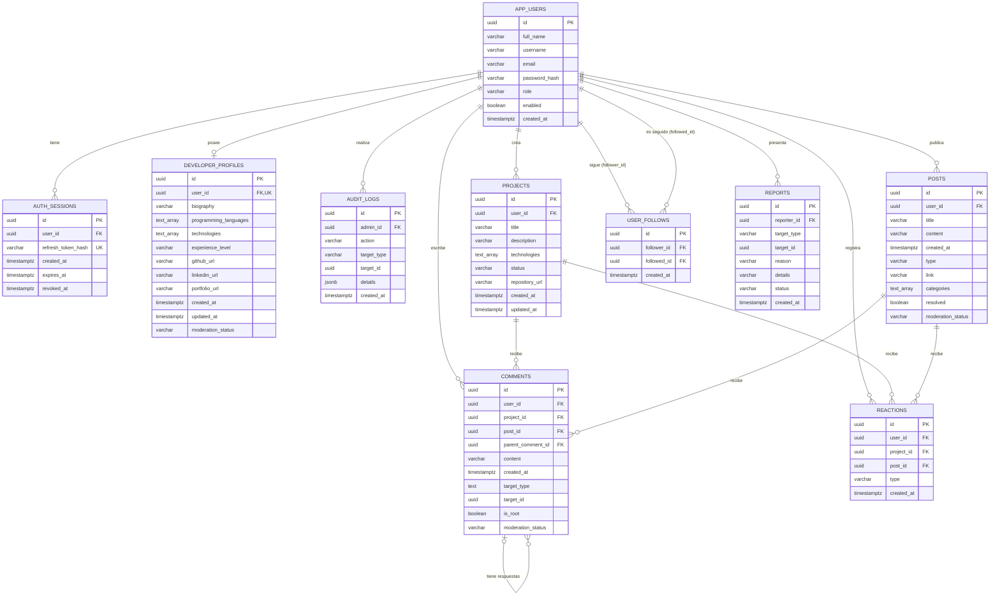

# Modelo entidad-relación — Fábrica Escuela

## 1. Objetivo

Representar las entidades principales de la plataforma Fábrica Escuela, sus atributos identificadores y las relaciones establecidas en el modelo físico de PostgreSQL. Las claves primarias se identifican como PK y las claves foráneas como FK.

## 2. Diagrama

## 3. Relaciones y cardinalidades

- **Usuarios y sesiones:** un usuario puede tener cero o muchas sesiones; cada sesión pertenece a un usuario.
- **Usuarios y perfiles:** un usuario puede tener cero o un perfil de desarrollador; cada perfil pertenece a un único usuario.
- **Usuarios y registros de auditoría:** un usuario puede estar asociado a cero o muchos registros de auditoría.
- **Usuarios y proyectos:** un usuario puede crear cero o muchos proyectos; cada proyecto pertenece a un usuario.
- **Usuarios y publicaciones:** un usuario puede crear cero o muchas publicaciones; cada publicación pertenece a un usuario.
- **Proyectos y comentarios:** un proyecto puede recibir cero o muchos comentarios.
- **Publicaciones y comentarios:** una publicación puede recibir cero o muchos comentarios.
- **Comentarios y respuestas:** un comentario puede tener cero o muchas respuestas, y una respuesta puede a su vez recibir respuestas (respuestas anidadas, desde la migración V14). La base de datos solo exige que el comentario padre exista; que pertenezca al mismo proyecto o publicación se controla en la aplicación.
- **Usuarios y reacciones:** un usuario puede registrar cero o muchas reacciones. Cada reacción apunta a un proyecto o a una publicación, pero no a ambos simultáneamente.
- **Usuarios y reportes:** un usuario puede presentar cero o muchos reportes. El destino del reporte se identifica mediante `target_type` y `target_id`.
- **Usuarios y seguimientos:** un usuario puede seguir a cero o muchos usuarios y ser seguido por cero o muchos. Cada fila de `user_follows` relaciona a un seguidor con un usuario seguido; no se permite que un usuario se siga a sí mismo ni repetir la misma pareja.

## 4. Consideraciones del modelo físico

- Las claves primarias se identifican con `PK`; las claves foráneas, con `FK`; y las restricciones de unicidad, con `UK`.
- Los comentarios y las reacciones utilizan una relación exclusiva con proyectos o publicaciones: solo uno de los dos identificadores puede tener valor.
- Los reportes utilizan `target_type` y `target_id` para identificar el elemento reportado. Esta referencia polimórfica no es una clave foránea directa hacia una sola tabla.
- Las tablas `posts`, `comments` y `developer_profiles` incluyen `moderation_status` (`VISIBLE`, `IN_REVIEW` o `REMOVED`), que permite ocultar contenido sin borrarlo.
- El modelo representa las tablas del esquema físico de PostgreSQL. Las restricciones, los índices y los tipos de datos definitivos deben verificarse en `schema.sql`.
