# Modelo entidad-relación — Fábrica Escuela

## 1. Objetivo

Representar las entidades principales de la plataforma Fábrica Escuela, sus atributos identificadores y las relaciones establecidas en el modelo físico de PostgreSQL. Las claves primarias se identifican como PK y las claves foráneas como FK.

## 2. Diagrama

```mermaid
erDiagram
    APP_USERS {
        uuid id PK
        varchar full_name
        varchar username
        varchar email
        varchar password_hash
        varchar role
        boolean enabled
        timestamptz created_at
    }

    AUTH_SESSIONS {
        uuid id PK
        uuid user_id FK
        varchar refresh_token_hash UK
        timestamptz created_at
        timestamptz expires_at
        timestamptz revoked_at
    }

    DEVELOPER_PROFILES {
        uuid id PK
        uuid user_id FK,UK
        varchar biography
        text_array programming_languages
        text_array technologies
        varchar experience_level
        varchar github_url
        varchar linkedin_url
        varchar portfolio_url
        timestamptz created_at
        timestamptz updated_at
        varchar moderation_status
    }

    AUDIT_LOGS {
        uuid id PK
        uuid admin_id FK
        varchar action
        varchar target_type
        uuid target_id
        jsonb details
        timestamptz created_at
    }

    PROJECTS {
        uuid id PK
        uuid user_id FK
        varchar title
        varchar description
        text_array technologies
        varchar status
        varchar repository_url
        timestamptz created_at
        timestamptz updated_at
    }

    POSTS {
        uuid id PK
        uuid user_id FK
        varchar title
        varchar content
        timestamptz created_at
        varchar type
        varchar link
        text_array categories
        boolean resolved
        varchar moderation_status
    }

    COMMENTS {
        uuid id PK
        uuid user_id FK
        uuid project_id FK
        uuid post_id FK
        uuid parent_comment_id FK
        varchar content
        timestamptz created_at
        text target_type
        uuid target_id
        boolean is_root
        varchar moderation_status
    }

    REACTIONS {
        uuid id PK
        uuid user_id FK
        uuid project_id FK
        uuid post_id FK
        varchar type
        timestamptz created_at
    }

    USER_FOLLOWS {
        uuid id PK
        uuid follower_id FK
        uuid followed_id FK
        timestamptz created_at
    }

    REPORTS {
        uuid id PK
        uuid reporter_id FK
        varchar target_type
        uuid target_id
        varchar reason
        varchar details
        varchar status
        timestamptz created_at
    }

    USER_BLOCKS {
        uuid id PK
        uuid blocker_id FK "quien bloquea"
        uuid blocked_id FK "usuario bloqueado"
        timestamptz created_at
    }

    CONVERSATIONS {
        uuid id PK
        uuid user_one_id FK "menor UUID del par"
        uuid user_two_id FK "mayor UUID del par"
        timestamptz created_at
        timestamptz last_message_at
    }

    MESSAGES {
        uuid id PK
        uuid conversation_id FK
        uuid sender_id FK
        text content "1 a 2000 caracteres"
        timestamptz created_at
    }

    NOTIFICATIONS {
        uuid id PK
        uuid recipient_id FK "destinatario"
        uuid actor_id FK "quien origina"
        varchar type "COMMENT, LIKE, FOLLOWER, MESSAGE"
        varchar target_type "POST, PROJECT, USER"
        uuid target_id "polimorfico, sin FK"
        varchar target_label
        timestamptz created_at
        timestamptz read_at "NULL = no leida"
    }

    APP_USERS ||--o{ AUTH_SESSIONS : "tiene"
    APP_USERS ||--o| DEVELOPER_PROFILES : "posee"
    APP_USERS ||--o{ AUDIT_LOGS : "realiza"
    APP_USERS ||--o{ PROJECTS : "crea"
    APP_USERS ||--o{ POSTS : "publica"
    APP_USERS ||--o{ COMMENTS : "escribe"
    APP_USERS ||--o{ REACTIONS : "registra"
    APP_USERS ||--o{ REPORTS : "presenta"
    APP_USERS ||--o{ USER_FOLLOWS : "sigue (follower_id)"
    APP_USERS ||--o{ USER_FOLLOWS : "es seguido (followed_id)"

    PROJECTS ||--o{ COMMENTS : "recibe"
    POSTS ||--o{ COMMENTS : "recibe"
    COMMENTS o|--o{ COMMENTS : "tiene respuestas"

    PROJECTS ||--o{ REACTIONS : "recibe"
    POSTS ||--o{ REACTIONS : "recibe"

    APP_USERS ||--o{ USER_BLOCKS : "bloquea (blocker_id)"
    APP_USERS ||--o{ USER_BLOCKS : "es bloqueado (blocked_id)"
    APP_USERS ||--o{ CONVERSATIONS : "participa (user_one_id)"
    APP_USERS ||--o{ CONVERSATIONS : "participa (user_two_id)"
    CONVERSATIONS ||--o{ MESSAGES : "contiene"
    APP_USERS ||--o{ MESSAGES : "envia (sender_id)"
    APP_USERS ||--o{ NOTIFICATIONS : "recibe (recipient_id)"
    APP_USERS ||--o{ NOTIFICATIONS : "origina (actor_id)"
```

## 3. Relaciones y cardinalidades

- **Usuarios y sesiones:** un usuario puede tener cero o muchas sesiones; cada sesión pertenece a un usuario.
- **Usuarios y perfiles:** un usuario puede tener cero o un perfil de desarrollador; cada perfil pertenece a un único usuario.
- **Usuarios y registros de auditoría:** un usuario puede estar asociado a cero o muchos registros de auditoría.
- **Usuarios y proyectos:** un usuario puede crear cero o muchos proyectos; cada proyecto pertenece a un usuario.
- **Usuarios y publicaciones:** un usuario puede crear cero o muchas publicaciones; cada publicación pertenece a un usuario.
- **Proyectos y comentarios:** un proyecto puede recibir cero o muchos comentarios.
- **Publicaciones y comentarios:** una publicación puede recibir cero o muchos comentarios.
- **Comentarios y respuestas:** un comentario puede tener cero o muchas respuestas, y una respuesta puede a su vez recibir respuestas (respuestas anidadas, desde la migración V14). La base de datos solo exige que el comentario padre exista; que pertenezca al mismo proyecto o publicación se controla en la aplicación.
- **Usuarios y reacciones:** un usuario puede registrar cero o muchas reacciones. Cada reacción apunta a un proyecto o a una publicación, pero no a ambos simultáneamente.
- **Usuarios y reportes:** un usuario puede presentar cero o muchos reportes. El destino del reporte se identifica mediante `target_type` y `target_id`.
- **Usuarios y bloqueos (Sprint 3, HU-11):** un usuario puede bloquear a cero o muchos usuarios y ser bloqueado por cero o muchos. No se permite bloquearse a sí mismo ni repetir la misma pareja `(blocker_id, blocked_id)`.
- **Usuarios y conversaciones (Sprint 3, HU-12):** un usuario participa en cero o muchas conversaciones, como `user_one_id` o como `user_two_id`. Cada conversación tiene exactamente dos participantes distintos, guardados en orden (`user_one_id < user_two_id`), y existe como máximo una conversación por pareja.
- **Conversaciones y mensajes (Sprint 3, HU-12):** una conversación contiene cero o muchos mensajes. Cada mensaje pertenece a una conversación y tiene un remitente (`sender_id`); el destinatario es el otro participante.
- **Usuarios y notificaciones (Sprint 3, HU-13):** un usuario recibe cero o muchas notificaciones (`recipient_id`) y origina cero o muchas (`actor_id`). El elemento al que se refiere la notificación se identifica con `target_type` y `target_id`.
- **Usuarios y seguimientos:** un usuario puede seguir a cero o muchos usuarios y ser seguido por cero o muchos. Cada fila de `user_follows` relaciona a un seguidor con un usuario seguido; no se permite que un usuario se siga a sí mismo ni repetir la misma pareja.

## 4. Consideraciones del modelo físico

- Las claves primarias se identifican con `PK`; las claves foráneas, con `FK`; y las restricciones de unicidad, con `UK`.
- Los comentarios y las reacciones utilizan una relación exclusiva con proyectos o publicaciones: solo uno de los dos identificadores puede tener valor.
- Los reportes utilizan `target_type` y `target_id` para identificar el elemento reportado. Esta referencia polimórfica no es una clave foránea directa hacia una sola tabla.
- Las notificaciones también usan una referencia polimórfica (`target_type`, `target_id`) sin clave foránea, y un índice único parcial evita duplicar notificaciones `LIKE` y `FOLLOWER` no leídas.
- Las conversaciones guardan ordenado el par de participantes para que exista una sola conversación por pareja de usuarios.
- Las tablas `posts`, `comments` y `developer_profiles` incluyen `moderation_status` (`VISIBLE`, `IN_REVIEW` o `REMOVED`), que permite ocultar contenido sin borrarlo.
- El modelo representa las tablas del esquema físico de PostgreSQL. Las restricciones, los índices y los tipos de datos definitivos deben verificarse en `schema.sql`.
